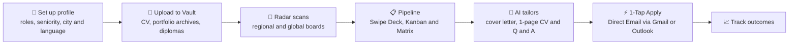
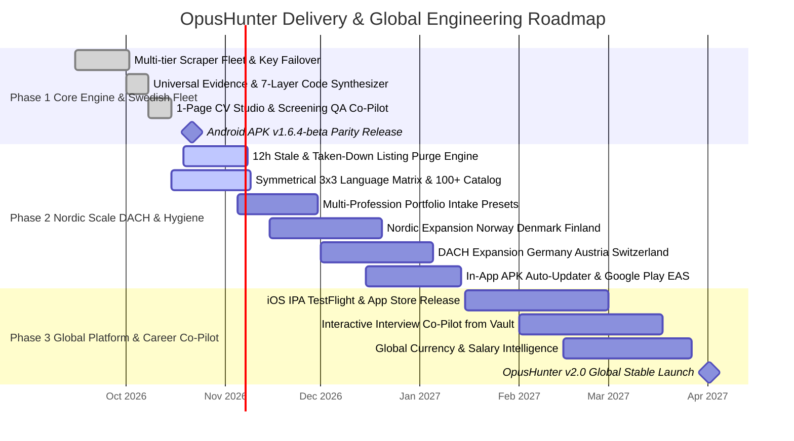
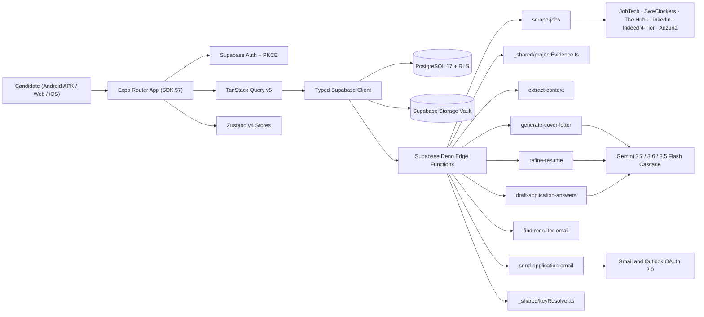

<div align="center">


# OpusHunter

### Your autonomous, evidence-grounded job application co-pilot

**Discover jobs. Tailor applications from your real portfolio & credentials. Apply in one tap.**
<br/>
Built for every profession and global market — perfected first in Sweden 🇸🇪 and the Nordics.

<br/>

<a href="https://github.com/AlexBuildsLTS/OpusHunter-Release/releases/latest"></a>
<a href="https://github.com/AlexBuildsLTS/OpusHunter-Release/releases/latest"></a>
<a href="https://opus-hunter.vercel.app/">
<a href="https://opus-hunter.vercel.app/">

<br/> 


<br/><br/>

<a href="https://github.com/AlexBuildsLTS/OpusHunter-Release/releases/tag/v1.6.4-beta">
  
</a>
&nbsp;


</div>

<br/>

---

## 📑 Contents

- [Why OpusHunter](#-why-opushunter)
- [Built for Every Profession & Country](#-built-for-every-profession--country)
- [Download & Install](#-download--install)
- [How It Works](#-how-it-works)
- [Feature Highlights](#-feature-highlights)
- [Job Sources & Geographic Coverage](#-job-sources--geographic-coverage)
- [Privacy, Control & Fair Access](#-privacy-control--fair-access)
- [Release Notes](#-release-notes)
- [Versioning & Release Policy](#-versioning--release-channel-policy)
- [Roadmap](#-roadmap)
- [Engineering Delivery Roadmap](#-engineering-delivery-roadmap)
- [Architecture & Component Topology](#-architecture--component-topology)
- [Repository Layout](#-repository-layout)
- [Technology Stack](#-technology-stack)
- [Long-Term Vision](#-long-term-vision)
- [FAQ](#-faq)
- [Support & Feedback](#-support--feedback)

---

## 💡 Why OpusHunter

Job hunting today is fragmented: a dozen job boards, scattered documents, browser tabs, spreadsheets, and the same cover letter rewritten fifty times. Most of it is repetition — and generic, unverified applications get filtered out by recruiters and ATS screeners.

**OpusHunter replaces the grind with intelligent, evidence-grounded preparation and dispatch:**

<table>
<tr>
<td width="33%" align="center">

### 🔭

**Discover**
<br/>
Aggregates jobs from Swedish, Nordic, and global sources into one clean, SHA-256 deduplicated pipeline.

</td>
<td width="33%" align="center">

### 🧠

**Tailor**
<br/>
Writes cover letters, 1-page CVs, and screening answers grounded in _your real_ work, portfolios, and diplomas — zero invented claims.

</td>
<td width="33%" align="center">

### ⚡

**Apply**
<br/>
Dispatches directly via your linked Gmail or Outlook account with your tailored cover letter and attached CV PDF in one tap.

</td>
</tr>
</table>

> **Controlled execution, always under your command.** You decide what gets generated and what gets sent. OpusHunter never fabricates experience.

---

## 🌍 Built for Every Profession & Country

While OpusHunter includes deep source-code inspection for software engineers, its **Evidence Intake Hub** and **Tailored Letter Engine** are architected for **any profession, any industry, and any country**:

| Profession / Field                           | What You Upload to the Vault                                                                            | How OpusHunter Uses Your Evidence                                                                               |
| :------------------------------------------- | :------------------------------------------------------------------------------------------------------ | :-------------------------------------------------------------------------------------------------------------- |
| 💻 **Software & IT**                         | CV, `.zip` code repositories, Repomix XML, technical certificates                                       | Inspects manifests, schemas, and architecture layers; matches exact stack requirements to the job ad.           |
| 🏗️ **Builders, Construction & Engineering**  | CV, project portfolios, technical drawings/specs (`.pdf`, `.zip`), trade licenses & safety certificates | Highlights delivered projects, site responsibilities, regulatory compliance, and verified trade certifications. |
| ⚖️ **Legal, Finance & Consulting**           | CV, academic degrees, bar/charter credentials, anonymized case or advisory summaries                    | Emphasizes verified qualifications, regulatory domains, analytical rigor, and client outcomes in formal prose.  |
| 🎨 **Design, Creative & Architecture**       | CV, portfolio archives, case studies, software/tool certifications                                      | Connects creative deliverables, tool mastery, and real project briefs to the employer's stated needs.           |
| 🏥 **Healthcare, Education & Public Sector** | CV, diplomas, vocational licenses (`Behörighetsintyg`), training records                                | Anchors applications strictly on verified credentials, issuers, dates, and clinical/educational experience.     |

---

## 📲 Download & Install

<div align="center">

| Platform                     |            Status            |                                            Get it                                            |
| :--------------------------- | :--------------------------: | :------------------------------------------------------------------------------------------: |
| 🤖 **Android (APK)**         | ✅ Available (`v1.6.4-beta`) | [**Latest Release →**](https://github.com/AlexBuildsLTS/OpusHunter-Release/releases/latest) |
| 🌐 **Web App**               |       ✅ Live Preview        |                              [**Responsive Desktop & Mobile Web →**](https://opus-hunter.vercel.app/)                             |
| ▶️ **Google Play Store**     |      🚧 In preparation       |                                         Coming soon                                          |
| 🍎 **iOS (App Store / IPA)** |          🗓️ Planned          |                                      Architecture ready                                      |

</div>

### Installing the APK on Android

1. Open the [**latest release**](https://github.com/AlexBuildsLTS/OpusHunter-Release/releases/latest) on your Android phone.
2. Under **Assets**, tap the `.apk` file to download it (`OpusHunter-v1.6.4-beta.apk`).
3. When prompted, allow your browser or file manager to **install unknown apps** (_Settings → Apps → Special access → Install unknown apps_).
4. Open the downloaded file and tap **Install**.
5. Launch **OpusHunter**, sign in with Google or email, and complete your profile.

> [!TIP]
> **Updating from an earlier version?** Install the new APK directly over the existing app — your profile, Document Vault, and pipeline live in Supabase cloud and stay 100% intact.

> [!NOTE]
> Android may display a standard "Play Protect" prompt for direct APK releases outside the Play Store. Tap **Install anyway** to proceed.

**Requirements:** Android 8.0 (Oreo, API 26) or newer · Internet connection · A Google or email account.

---

## 🔄 How It Works



1. **Configure your profile** — target roles, seniority levels, preferred cities (with GPS lock), and your preferred AI/CV language from **100+ supported languages**.
2. **Populate your Document Vault** — upload your CV (`.pdf` / `.docx`), project or portfolio archives (`.zip` / Repomix XML), and diplomas/certificates. OpusHunter indexes every verified fact.
3. **Run the Job Radar** — fresh listings are harvested, translated across your target search languages, and deduplicated via SHA-256.
4. **Triage your pipeline** — swipe cards in the Discovery Deck, drag across Kanban columns, or filter in the Matrix view.
5. **Tailor & verify** — generate a native-language cover letter with a deterministic ATS score, refine a 1-page CV PDF, or draft answers to employer screening questions.
6. **Apply in one tap** — send directly via your linked Gmail or Outlook account when a hiring email address is found, complete with your tailored cover letter and attached CV PDF.

---

## ✨ Feature Highlights

### 🎯 Anchored Card Actions & 1-Tap "View Listing" Button (`SwipeDeck.tsx`)

- **Anchored Bottom Section**: Wrapped card bottom actions in `cardBottomSection` with `marginTop: "auto"`, guaranteeing rock-solid, symmetrical button placement on Android APK, iOS, and Web regardless of listing description height.
- **Direct 1-Tap Listing Access**: Decoupled the **"View Listing"** button from description length constraints so any listing with a valid source URL provides an immediate 1-tap link styled with the amber `Ad` icon.
- **Symmetrical Specification Trigger**: Cleanly partitioned the **"View Specifications & Strategy"** trigger with the amber `SendToBack` icon and calibrated 48px touch targets.

### 🏛️ Twin Flagship Architectural Hierarchy (`projectEvidence.ts`)

- **6-Layer Fullstack & BaaS Synthesis**: Evaluates codebases across 6 architectural layers (UI, Navigation, State, Backend & Edge Services, Database/RLS, DevOps/CI-CD). Recognizes Supabase RLS and Deno Edge Services, elevating OpusHunter alongside VeraxAI into verified twin flagship status.
- **Strict Flagship Demarcation**: Reserved primary and secondary flagship labels strictly for index 0 and 1, ensuring lower-tier supporting projects (`idx >= 2`) are presented solely as technical breadth and never mislabeled as flagships.
- **Self-Healing Verification Loop**: Deterministic verification pass verifies that both flagship systems are cited in generated letters, triggering an autonomous self-correcting pass if an omission occurs.

### 🔗 Dual-Compatible Markdown Hyperlinks & Auto-Sanitizer

- **Clean Project Name Links**: Prompts instruct Gemini to write clean, natural markdown hyperlinks (`[VeraxAI →](URL)`, `[OpusHunter →](URL)`) rather than verbose boilerplate suffixes like `[VeraxAI Production Release →](URL)`.
- **Automated Spacing Sanitizer**: Built-in regex normalizer (`normalizeGeneratedLetterBody`) automatically repairs accidental spaces between closing brackets and opening parentheses (`[Name  →] (URL)` becomes `[Name →](URL)`), ensuring hyperlinks remain interactive across all markdown viewers and PDF exporters.
- **Universal Multi-User Scaling**: Dynamic evidence formatting automatically calibrates prompts whether a candidate has 2+ flagships, 1 flagship, or 0 codebases (grounding cleanly on verified experience and diplomas).

### 🎛️ AI Formality & Strategy Engine Parity (`index.tsx`, `pipeline.tsx`)

- **5 Distinct Formality Profiles**:
  1. **Professional**: Confident, direct, and universally balanced.
  2. **Technical Deep-Dive**: Written for Engineering Managers and Architects; details exact concurrency models, C++ NDK binaries, Supabase RLS, and schemas.
  3. **Formal Corporate**: Traditional, polished business register for enterprise, banking (SEB, Handelsbanken), and public sector.
  4. **Executive Brief**: Concise, high-signal, outcome-first delivery for time-pressed hiring managers.
  5. **Storytelling**: Engaging narrative journey linking career milestones to system creation.
- **Dual Targeting Engines**: Instant 1-tap selection between **ATS Keyword Mirroring** (exact job-ad vocabulary reuse) and **Achievement Amplifier** (scale, architectural mechanisms, and hard engineering trade-offs).

### 🌐 Universal 100+ Language Engine & Symmetrical 3×3 Quick-Access Selector

- **Symmetrical 3×3 Quick-Access Matrix**: Instant 1-tap switching across your 9 primary regional languages (`profile.tsx` & `cover-letter/[id].tsx`) without UI layout shifts:
  - 🇸🇪 **Svenska (Swedish)** · 🇬🇧 **English (UK)** · 🇺🇸 **English (US)**
  - 🇩🇪 **Deutsch (German)** · 🇳🇴 **Norsk (Norwegian)** · 🇩🇰 **Dansk (Danish)**
  - 🇫🇮 **Suomi (Finnish)** · 🇳🇱 **Nederlands (Dutch)** · 🇫🇷 **Français (French)**
- **1-Tap 100+ Language Search Drawer**: Compact top-right switcher opens an instant, search-indexed catalog of 100+ ISO-standard languages with real-time Supabase cloud synchronization across Android APK and Web.
- **Dialect Detection & Cultural Formality**: Distinguishes regional subtleties (e.g., Riksmål vs. Nynorsk, British vs. American English, formal German Sie vs. du) with culturally authentic sign-offs.

### 📝 Unified Concise Listing Overview Engine (`lib/listingSummary.ts`)

- **Instant Structured Role Briefs**: Synthesizes clean, professional position summaries across Discovery Deck cards (`SwipeDeck.tsx`) and pipeline inspection modals (`index.tsx`, `pipeline.tsx`).
- **No More Vague Placeholders**: Permanently eliminates unhelpful `"The full description is available on the original posting"` texts and raw unformatted key-value dumps.
- **Domain-Aware Synthesis**: Automatically detects technical domains (frontend, backend, systems, mobile, DevOps, legal, healthcare, construction) and highlights key scope and responsibilities even when source boards provide sparse or truncated text.

### 📄 AI CV Refiner & 4-Template 1-Page PDF Studio

- Rewrites and condenses your CV around verified vault evidence without fabricating a single skill.
- Choose between **4 executive A4 templates**:
  1. **Modern Executive** (2-column calibrated navy sidebar, circular photo ring, categorized skill badges)
  2. **Nordic Clean Slate** (Scandinavian 1-column slate banner, 2×2 skill grid, framed project cards)
  3. **Technical Systems** (High-density 1-column engineering layout with monospace stack tags)
  4. **Clean Executive ATS** (Strict linear 1-column parser-first flow with crisp horizontal dividers)
- Export and share as a print-ready A4 PDF directly from Android APK, iOS, or Web.

### 💬 Screening Question Co-Pilot

- Paste employer screening questions or upload a screenshot of an application form.
- OpusHunter drafts honest, copy-ready answers grounded in your profile and evidence ledger — distinguishing direct experience from adjacent experience so you never overclaim.

### 🎯 Deterministic ATS Scoring

- **Real formula**: `60%` verified skill match + `25%` structured requirements (years of experience, education, language, seniority) + `15%` letter articulation.
- **Filler-phrase detection**: Flags clichés in English, Swedish, and other languages so your letter stays sharp and specific.
- **Actionable gap reporting**: Shows matched requirements and missing requirements so you know exactly what proof to upload next.

### 🔬 7-Layer Codebase Architecture Synthesis (`extract-context`)

- Evaluates uploaded `.zip` repositories and Repomix XML archives across **7 deterministic architectural layers**:
  1. **Entry Points & Routing** · 2. **Client State & Caching** · 3. **Business Logic & Services**
  4. **Persistence & Schemas** · 5. **External API Integrations** · 6. **Authentication & Security** · 7. **Test Suites & CI/CD**
- Extracts verified technical proof directly into cover letters and screening answers without manual copy-pasting.

### 🧹 Automated 12-Hour Stale / Taken-Down Listing Purge

- **Background Hygiene Routine**: Automated scheduler executes every 12 hours to verify that listings in the discovery queue remain active on their source job boards.
- **Upstream Liveness Validation**:
  - 🇸🇪 **JobTech**: Queries `GET /ad/{id}` to detect closed postings (`404` or `removed: true`).
  - 🚀 **The Hub**: Queries `/jobs/single/{id}` to detect expired postings (`404` or `closed: true`).
  - 🌐 **SweClockers & Direct Web Feeds**: Executes lightweight HTTP `HEAD` probes detecting `404 Not Found` or `410 Gone`.
- **Zero Data Loss Guarantee**: Un-triaged dead listings are purged from discovery feeds to save candidate time. **Crucially, all jobs with existing candidate applications in `job_applications` are strictly preserved forever** with immutable timestamps, sent emails, and tailored letters.

### 📧 Silent Recruiter Email Discovery

- Searches for official hiring or recruiter emails (`careers@`, `jobb@`, `hr@`, or named contacts) via Hunter.io and job description analysis as soon as you inspect a role.
- Promotes **Send via Gmail / Outlook** to a one-tap primary action when a verified email route is available.

### 🎨 Liquid Neon Aerospace UI & Cross-Platform Parity

- High-contrast frosted obsidian cards (`constants/theme.ts`) designed for zero text bleed-through on OLED phones and desktop monitors.
- Universal `ProfileDropdown` and adaptive navigation shell (`AdaptiveLayout`) with 48px minimum touch targets, safe-area inset math, and 120fps Reanimated transitions.
- Optional tactile micro-electric arcs and concentric cyber rings that respect system reduced-motion preferences.

---

## 🌐 Job Sources & Geographic Coverage

OpusHunter combines official national employment databases, niche specialist boards, and resilient multi-tier fallbacks. Phase 1 establishes complete coverage in Sweden, scaling across the Nordics, DACH, Benelux, and global markets in Phase 2 & 3:

| Region / Market              |           Status           | Primary Sources & Integration Method                                                                                                                                                                                                                                                                                                                                                        | Focus Areas                                                               |
| :--------------------------- | :------------------------: | :------------------------------------------------------------------------------------------------------------------------------------------------------------------------------------------------------------------------------------------------------------------------------------------------------------------------------------------------------------------------------------------ | :------------------------------------------------------------------------ |
| 🇸🇪 **Sweden**                |   ✅ **Live & Hardened**   | • **JobTech Open API (Arbetsförmedlingen)**: Platsbanken public feed<br/>• **SweClockers Jobb**: Direct-mailto IT, systems & engineering board<br/>• **The Hub Sweden**: Direct startup and scale-up REST API<br/>• **Indeed Multi-Tier Radar**: 4-gateway fallback (`indeed-sweden` → `indeed12` → `jobs-api14` → `jsearch`)<br/>• **LinkedIn & Adzuna**: Specialist & enterprise listings | All professions, IT/tech, engineering, healthcare, trades & public sector |
| 🇳🇴 **Norway**                | 🚧 **Phase 2 (In Engine)** | • **NAV Arbeidsplassen API**: Norway's official public labor database<br/>• **Finn.no Jobb**: Norway's leading commercial employment board<br/>• **The Hub Norway**: Oslo & Bergen startup ecosystem                                                                                                                                                                                        | Tech, maritime, energy, healthcare & general industry                     |
| 🇩🇰 **Denmark**               | 🚧 **Phase 2 (In Engine)** | • **Jobindex API**: Denmark's primary commercial job index<br/>• **Jobnet (STAR)**: Danish national employment service<br/>• **The Hub Denmark**: Copenhagen tech & scale-up ecosystem                                                                                                                                                                                                      | Life sciences, fintech, software engineering & consulting                 |
| 🇫🇮 **Finland**               | 🚧 **Phase 2 (In Engine)** | • **Työmarkkinatori API**: Finnish national job market platform<br/>• **The Hub Finland**: Helsinki startup & technology ecosystem                                                                                                                                                                                                                                                          | Deep tech, gaming, forestry/engineering & public sector                   |
| 🇩🇪 **Germany**               | 🚧 **Phase 2 (In Engine)** | • **Bundesagentur für Arbeit (BA API / Jobsuche)**: Official German public feed<br/>• **StepStone & Indeed DE**: Commercial industry radar                                                                                                                                                                                                                                                  | Automotive, enterprise IT, manufacturing, finance & engineering           |
| 🇦🇹 **Austria**               | 🚧 **Phase 2 (In Engine)** | • **AMS eJob-Room API**: Austrian public employment service<br/>• **karriere.at**: Major Austrian employment marketplace                                                                                                                                                                                                                                                                    | Industrial engineering, IT, tourism & healthcare                          |
| 🇨🇭 **Switzerland**           | 🚧 **Phase 2 (In Engine)** | • **jobs.ch**: Switzerland's primary multi-lingual job board<br/>• **job-room.ch (SECO/PLSTA API)**: Swiss federal employment portal                                                                                                                                                                                                                                                        | Banking, biotech, luxury goods & multinational tech                       |
| 🇳🇱 **Netherlands**           | 🚧 **Phase 2 (In Engine)** | • **UWV Werk.nl**: Dutch national employment service<br/>• **Indeed NL & LinkedIn**: Randstad tech & logistics hub                                                                                                                                                                                                                                                                          | Software, logistics, agronomy & multinational corporate                   |
| 🇬🇧 **United Kingdom**        | 🚧 **Phase 2 (In Engine)** | • **Reed.co.uk API**: Direct UK recruiter & agency integration<br/>• **Adzuna UK**: Comprehensive national job aggregator                                                                                                                                                                                                                                                                   | Financial services, healthcare (NHS), creative & tech                     |
| 🇺🇸 **United States**         | 🚧 **Phase 2 (In Engine)** | • **Adzuna US & USAJOBS API**: National private & federal job feeds<br/>• **Indeed US & LinkedIn**: Nationwide high-yield radar                                                                                                                                                                                                                                                             | Tech, defense, healthcare, consulting & trade sectors                     |
| 🌍 **Pan-European & Global** |   ✅ **Live / Scaling**    | • **LinkedIn Global**: International remote & enterprise listings<br/>• **Indeed Multi-Tier Radar**: 4-gateway international coverage<br/>• **EURES**: European Job Mobility Portal (Phase 3)                                                                                                                                                                                               | Borderless remote work, relocation & global talent mobility               |

---

## 🔒 Privacy, Control & Fair Access

- **Human-in-the-loop always.** Nothing is emailed or marked as applied without your explicit action.
- **Your email, your identity.** Gmail and Outlook are linked via official OAuth 2.0 PKCE (`oauth-link-email`) with automatic token health checks (`check-email-account`).
- **Row-Level Security (RLS).** Every PostgreSQL table and storage bucket enforces `auth.uid() = user_id` isolation.
- **PIN-encrypted BYOK Vault.** Power users can store personal Gemini, RapidAPI, or Hunter.io keys protected by hardware-backed secure storage and PIN verification.
- **Fair Access & Pricing / Limits Transparency**: Limits and quota rules for standard Member and Premium tiers are under ongoing evaluation and will not be finalized until full platform stability is reached. Administrator accounts operate with zero limits. All users currently enjoy generous AI generation access to thoroughly test and explore the system.

---

## 📝 Release Notes

### 🚀 v1.6.4-beta (Current Release)

- **Anchored Deck Actions & Direct "View Listing" Button (`SwipeDeck.tsx`)**: Re-anchored card action buttons with `marginTop: "auto"` for rock-solid symmetry across Android APK, iOS, and Web. Guaranteed instant 1-tap "View Listing" button access with the amber `Ad` icon alongside the "View Specifications & Strategy" trigger with the amber `SendToBack` icon.
- **Twin Flagship Architectural Hierarchy (`projectEvidence.ts`)**: Elevated fullstack BaaS/Edge layer detection so OpusHunter and VeraxAI stand together as twin verified production flagships, while strictly restricting flagship designations to index 0 and 1.
- **Dual-Compatible Markdown Hyperlinks & Auto-Sanitizer (`generate-cover-letter`)**: Generates clean, concise markdown hyperlinks (`[VeraxAI →](URL)`, `[OpusHunter →](URL)`) without verbose suffixes. Built-in regex sanitizer normalizes accidental whitespace between brackets and parentheses (`[Name] (URL)` -> `[Name](URL)`).
- **Formality & Strategy Engine Parity (`index.tsx`, `pipeline.tsx`)**: Unified all 5 Formality Profiles (`Professional`, `Technical Deep-Dive`, `Formal Corporate`, `Executive Brief`, `Storytelling`) across Discovery Dashboard and Applications Pipeline.
- **Unified Concise Listing Overview Engine (`lib/listingSummary.ts`)**: Synthesizes structured, professional position summaries across the Discovery Deck (`SwipeDeck.tsx`) and Pipeline inspection modals (`index.tsx`, `pipeline.tsx`). Replaced unformatted key-value lines and completely eliminated `"The full description is available on the original posting"`.
- **Hardened Multi-Tier Scraper Fleet (`supabase/functions/scrape-jobs/adapters/`)**: Fixed provider logging in `indeed.ts` (`"rapidapi"` vs invalid `"indeed"`), expanded publisher listing domain validation, added domain-aware structured fallback descriptions across `indeed.ts`, `sweclockers.ts`, `thehub.ts`, and `adzuna.ts`, and filtered out unformatted or invalid titles/URLs.
- **Automated 12-Hour Stale / Taken-Down Listing Purge Architecture**: Engineered background hygiene design that verifies listing liveness against JobTech (`GET /ad/{id}` for 404/removed), The Hub (`closed: true`), and Web boards (HEAD probes for 404/410), while strictly preserving all candidate application history.
- **Universal Symmetrical 3×3 Language Switcher & 100+ Catalog (`profile.tsx`, `cover-letter/[id].tsx`)**: Fast 1-tap switching between 9 primary regional languages with instant corner access to the full 100+ language catalog and real-time Supabase synchronization.
- **Android 13+ Granular Permissions & Build Calibration (`app.json`)**: Bumped version to `1.6.4` (code `164`), configured `expo-image-picker` plugin permissions explicitly, and added `READ_MEDIA_IMAGES` for modern Android devices.
- **4-Template 1-Page CV Studio & Screening Co-Pilot**: Modern Executive, Nordic Clean Slate, Technical Systems, and Clean Executive ATS with native PDF vector export; text and screenshot intake for screening questions.
- **7-Layer Codebase Architecture & Evidence Intake (`extract-context`, `projectEvidence.ts`)**: Repomix XML virtual file explosion, multi-manifest project grouping, and certificate curriculum/date extraction.

### ⚡ v1.5.0-beta

- Added 4-tier Indeed & RapidAPI scraper fallback (`indeed-sweden`, `indeed12`, `jobs-api14`, `jsearch`) alongside JobTech, SweClockers, The Hub, and LinkedIn.
- Added Admin Kernel Command Center (`admin/index.tsx`, `admin/api-keys.tsx`, `admin/users.tsx`) with pure-SVG token burn velocity charts, traffic share donuts, and fleet key rotation.
- Improved Quick Apply modal button layouts and 48px touch targets on Android APK.

### 📦 v1.0.0 Alpha

- Initial multi-source job Radar, Swipe Deck, Kanban board, Document Vault, and Gemini cover letter generation.

---

## 🏷️ Versioning & Release Channel Policy

| Channel                      | Artifact                           | Target Audience                     | Distribution                                                                    |
| :--------------------------- | :--------------------------------- | :---------------------------------- | :------------------------------------------------------------------------------ |
| **Beta (Current)**           | `build-1792015800367.apk` (156 MB) | Testers, power users & contributors | [GitHub Releases](https://github.com/AlexBuildsLTS/OpusHunter-Release/releases) |
| **Production (Coming Soon)** | `.aab` (Google Play bundle)        | General public                      | Google Play Store                                                               |
| **iOS (Architecture Ready)** | `.ipa` / TestFlight                | iOS testers                         | Apple App Store & TestFlight                                                    |
| **Web Preview**              | Responsive Web App                 | Desktop & mobile browser users      | [Hosted Web Preview](https://opus-hunter.vercel.app/)                           |

---

## 🗺️ Roadmap

```mermaid
flowchart LR
    subgraph Phase1["🟢 Phase 1: Core Engine & Sweden (v1.6.4 Beta - Current)"]
        A1["Android APK & Web Parity"]
        A2["Symmetrical 3x3 Language Matrix (100+ Languages)"]
        A3["1-Page CV Studio (4 A4 Templates)"]
        A4["Screening Question Co-Pilot"]
        A5["7-Layer Codebase Synthesizer"]
        A6["Swedish Radar (JobTech, SweClockers, The Hub)"]
        A7["Unified Concise Listing Overview Engine"]
    end
    subgraph Phase2["🔵 Phase 2: Nordic Scale, DACH & Hygiene (v1.7 - v1.9 Beta)"]
        B1["12-Hour Stale / Taken-Down Listing Purge Engine"]
        B2["Nordic Adapters (Norway, Denmark, Finland)"]
        B3["DACH Adapters (Germany, Austria, Switzerland)"]
        B4["All-Profession Portfolio Intake Presets"]
        B5["In-App APK Release Checker"]
        B6["Google Play Store AAB Submission"]
    end
    subgraph Phase3["🟣 Phase 3: Global Platform & Career Co-Pilot (v2.0 Stable)"]
        C1["iOS App Store & TestFlight Launch"]
        C2["Global Currency & Salary Intelligence"]
        C3["Codebase & Portfolio Interview Co-Pilot"]
        C4["Application Outcome & Conversion Analytics"]
    end
    Phase1 --> Phase2 --> Phase3
```



### 🟢 Shipped in v1.6.4 Beta

- [x] Android APK release (`v1.6.4-beta`, build code `164`) with 120fps gesture & modal parity
- [x] Universal 100+ language AI & CV engine with symmetrical 3×3 selector and instant catalog drawer
- [x] Unified Concise Listing Overview Engine (`getConciseListingSummary`) across Discovery Deck and Pipeline
- [x] 4-template 1-page CV Refiner & PDF exporter (`Modern Executive`, `Nordic Clean`, `Technical Systems`, `Clean ATS`)
- [x] Employer Screening Question Co-Pilot (text & screenshot form intake)
- [x] 1-Tap Gmail & Outlook application dispatch with token health verification
- [x] Multi-Tier Radar Scraper Engine (JobTech Sweden, SweClockers, The Hub, 4-Tier Indeed, Adzuna, LinkedIn)
- [x] Codebase Architecture Synthesis & 7-layer technology evaluation (`extract-context`)
- [x] Deep project archive (`.zip` / Repomix XML) & diploma evidence ledger
- [x] Deterministic ATS Scoring Hardening & Honest Skill Matching Formula (60% / 25% / 15%)
- [x] Android 13+ granular media permissions (`READ_MEDIA_IMAGES`) and image picker plugin hardening

### 🔵 Phase 2 — v1.7 to v1.9 Beta (Nordics, DACH & Automated Hygiene)

- [ ] **Automated 12-Hour Stale / Taken-Down Listing Purge**: Background hygiene routine checking upstream liveness (JobTech, The Hub, SweClockers, Web) and removing closed postings while preserving application logs
- [ ] **Nordic Expansion**: Dedicated country adapters for Norway (NAV Arbeidsplassen, Finn.no), Denmark (Jobindex, Jobnet), and Finland (Työmarkkinatori)
- [ ] **DACH Expansion**: Dedicated country adapters for Germany (Bundesagentur für Arbeit, StepStone), Austria (AMS eJob-Room), and Switzerland (jobs.ch, job-room.ch)
- [ ] **Benelux & Western Europe**: UWV Werk.nl (Netherlands), Reed.co.uk & Adzuna direct feeds (UK & US)
- [ ] **All-Profession Portfolio Intake Presets**: Curated intake models for construction/builders, legal, healthcare, design, finance, and trades
- [ ] **In-App Release Notifier**: Automatic background check against `AlexBuildsLTS/OpusHunter-Release` tags so Android APK users receive 1-tap update prompts
- [ ] **Google Play Store Launch**: Production AAB submission via EAS

### 🟣 Phase 3 — v2.0 Stable & Beyond (Global Career Co-Pilot)

- [ ] **iOS App Store & TestFlight Launch**: Full feature parity on Apple devices
- [ ] **Interactive Interview Co-Pilot**: Role-specific mock interview questions and briefs generated from your uploaded portfolio, codebase, and the job ad
- [ ] **Global Currency & Salary Intelligence**: Purchasing-power adjusted compensation insights (SEK, NOK, DKK, EUR, GBP, USD, CHF) mapped to local tax brackets
- [ ] **Application Outcome Analytics**: Conversion and response rates tracked across industries, cities, languages, and cover-letter strategies

---

## 📅 Engineering Delivery Roadmap



### Detailed Milestone Breakdown

| Version                   |  Channel   |        Target Date        | Core Deliverables & Geographic Milestones                                                                                                                                                                                                                                                                                                                                                                                                                                                                                             |
| :------------------------ | :--------: | :-----------------------: | :------------------------------------------------------------------------------------------------------------------------------------------------------------------------------------------------------------------------------------------------------------------------------------------------------------------------------------------------------------------------------------------------------------------------------------------------------------------------------------------------------------------------------------ |
| **v1.0.0 – v1.0.4**       | **Alpha**  | **Sept – Early Oct 2026** | Core prototype, initial Supabase schema, basic job scraping, and first internal Android APK builds.                                                                                                                                                                                                                                                                                                                                                                                                                                   |
| **v1.5.0-beta**           |  **Beta**  |   **Mid October 2026**    | 4-Tier Indeed/RapidAPI radar failover, Admin Kernel command center, pure-SVG telemetry, BYOK vault.                                                                                                                                                                                                                                                                                                                                                                                                                                   |
| **v1.6.4-beta (Current)** |  **Beta**  |   **October 21, 2026**    | **Full APK/Web UI Parity, Evidence Engine & Concise Overview**: Unified `getConciseListingSummary` across Discovery Deck & Pipeline; Symmetrical 3×3 Quick-Access language matrix + 100+ Gemini language catalog; 4-template 1-Page CV Studio; Screening Question Co-Pilot; 7-layer Codebase Architecture synthesis (`extract-context`); 1-Tap direct Email (Gmail/Outlook) dispatch; Scraper adapter hardening (JobTech, SweClockers, The Hub, 4-tier Indeed, Adzuna); Android 13+ granular media permissions (`READ_MEDIA_IMAGES`). |
| **v1.7.0-beta**           |  **Beta**  |     **November 2026**     | **Automated 12-Hour Stale Listing Purge & Nordic Scale**: Background hygiene engine detecting taken-down listings across JobTech, The Hub, and Web boards; dedicated job adapters for Norway (NAV / Finn.no), Denmark (Jobindex), and Finland (Työmarkkinatori); in-app APK update checker.                                                                                                                                                                                                                                           |
| **v1.8.0-beta**           |  **Beta**  |     **December 2026**     | **DACH Region Expansion & Multi-Profession Intake**: Dedicated adapters for Germany (Bundesagentur für Arbeit, StepStone), Austria (AMS), and Switzerland (jobs.ch); guided intake presets for builders/construction, legal, healthcare, design, and trades.                                                                                                                                                                                                                                                                          |
| **v1.9.0-beta**           |  **Beta**  |     **January 2027**      | **Play Store Production Gate & Western Europe**: Google Play Store production AAB submission via EAS; Benelux (UWV Werk.nl) & UK/US (Reed.co.uk / Adzuna) direct feeds; candidate response rate & application telemetry.                                                                                                                                                                                                                                                                                                              |
| **v2.0.0**                | **Stable** |     **Q1 – Q2 2027**      | **Global Stable GA & Career Co-Pilot**: Apple iOS App Store & TestFlight release; interactive Interview Co-Pilot trained on portfolio evidence; purchasing-power adjusted multi-currency salary intelligence (SEK, NOK, DKK, EUR, GBP, USD, CHF).                                                                                                                                                                                                                                                                                     |

---

## 🏗️ Architecture & Component Topology



---

## 📂 Repository Layout

```text
OpusHunter/
├── app/
│   ├── _layout.tsx                         Root layout, animated background & auth guard
│   ├── (auth)/                             Sign-in, visual onboarding & 5-step profile wizard
│   ├── (tabs)/
│   │   ├── _layout.tsx                     Universal AdaptiveLayout navigation shell
│   │   └── (dashboard)/
│   │       ├── index.tsx                   Discovery Swipe Deck & live metrics
│   │       ├── pipeline.tsx                Kanban board, Matrix view & Quick Apply sheet
│   │       ├── rules.tsx                   Radar scan rules & geographic targeting
│   │       ├── admin/                      Kernel command center, user registry & API key fleet
│   │       └── settings/                   Profile, Document Vault, BYOK security & Email linking
│   ├── apply/[id].tsx                      Application preparation & dispatch screen
│   ├── cover-letter/[id].tsx               Cover letter editor, language switcher & regeneration
│   └── job/[id].tsx                        Job specification & tailored synthesis trigger
├── components/
│   ├── jobcardsetup/                       SwipeDeck, KanbanBoard, RadarRulesEditor, Wizard
│   ├── layout/                             AdaptiveLayout & safe-area PageContainer
│   ├── shared/                             ProfileDropdown, AnimatedBackground, MicroArcOverlay
│   └── ui/                                 GlassCard, Modal, Button, Badge, Chip, Toast, Stepper
├── constants/                              Single-source theme tokens (theme.ts) & springs
├── hooks/                                  useJobs, useGmail, useOutlook, useAdaptiveLayout
├── lib/                                    generateCvHtml, generateAtsPdf, listingSummary, geo, skills, supabase
├── stores/                                 authStore, jobStore, coverLetterStore, uiStore
├── types/                                  database.types.ts, app.types.ts, emailLinking.types.ts
└── supabase/
    └── functions/
        ├── _shared/                        gemini, atsScoring, projectEvidence, keyResolver, geo
        ├── check-email-account/            Verifies live OAuth refresh token health
        ├── draft-application-answers/      Screening question co-pilot (text & screenshots)
        ├── extract-context/                CV, diploma & ZIP/Repomix portfolio analyzer
        ├── find-recruiter-email/           Hunter.io + domain & description email resolver
        ├── generate-cover-letter/          Polyglot cover-letter engine with claim verification
        ├── geo-autocomplete/               European & global city autocomplete
        ├── oauth-link-email/               Platform-aware Gmail & Outlook OAuth code exchange
        ├── purge-stale-jobs/               Automated 12h liveness verification & taken-down listing purge
        ├── refine-resume/                  Evidence-grounded 1-page CV refiner
        ├── save-api-key/                   Encrypted BYOK key persistence
        ├── scrape-jobs/                    Multi-source job radar (JobTech, SweClockers, The Hub, Indeed, Adzuna)
        ├── send-application-email/         Direct Gmail & Microsoft Graph dispatcher
        └── submit-application/             Application record & status verification handler
```

---

## 🛠️ Technology Stack

| Domain                     | Technology                                                                 | Purpose                                                                                                     |
| -------------------------- | -------------------------------------------------------------------------- | ----------------------------------------------------------------------------------------------------------- |
| **Mobile & Web Framework** | Expo SDK `~57.0.28` / React Native `0.86.3`                                | Cross-platform native builds for Android APK, iOS IPA, and Desktop/Mobile Web.                              |
| **Language & Typing**      | TypeScript `~6.0.3` + Zod `^3.25`                                          | End-to-end compile-time and runtime schema validation across client and Deno edge functions.                |
| **Navigation**             | Expo Router `~57.0.25`                                                     | File-based typed routing (`Href`), deep linking, and adaptive sidebar/tab shells.                           |
| **Animation & Gestures**   | Reanimated `4.5.1` + Gesture Handler `~2.32.0`                             | 120fps UI-thread physics for SwipeDeck, Kanban drag-and-drop, and popovers.                                 |
| **Styling & Tokens**       | NativeWind `^4.2.5` + `constants/theme.ts`                                 | Frosted obsidian glass surfaces with high-contrast cyan, emerald, and purple accents.                       |
| **State & Caching**        | TanStack Query `^5.99` + Zustand `^4.5`                                    | Optimistic pipeline updates, query deduplication, and persistent client state.                              |
| **Backend & Database**     | Supabase (PostgreSQL 17 + RLS)                                             | Row-level security, realtime telemetry channels, and secure RPCs.                                           |
| **Serverless Runtime**     | Deno (Supabase Edge Functions)                                             | Isolated serverless compute for scraping, archive unpacking (`fflate`), PDF/DOCX parsing, and AI synthesis. |
| **AI Inference Cascade**   | Google Gemini (`3.7-flash` → `3.6-flash` → `3.5-flash` → `3.5-flash-lite`) | Multi-model, multi-key failover for zero-downtime cover letters, CV refinement, and Q&A drafting.           |
| **Document Generation**    | `pdf-lib` + `expo-print` + `generateCvHtml.ts`                             | Client-side vector PDF and 4-template A4 HTML/PDF resume rendering.                                         |

---

## 🔭 Long-Term Vision

OpusHunter is built to be **the universal operating system for career mobility** — from your first uploaded credential to your signed offer, in any profession and any country.

| Horizon                            | Goal                                                                                                                                                               |
| ---------------------------------- | ------------------------------------------------------------------------------------------------------------------------------------------------------------------ |
| 🧰 **Universal Portfolio Proof**   | Let anyone — software engineer, builder, architect, lawyer, nurse, or designer — turn real work samples, drawings, and diplomas into undeniable application proof. |
| 🌐 **Borderless Polyglot Search**  | Search jobs in one country and apply in the employer's native language with culturally accurate CVs and cover letters across 100+ languages.                       |
| 🤝 **Interview Co-Pilot**          | Company briefs, likely interview questions derived from the job ad and your own portfolio, and interactive practice.                                               |
| 🏫 **Schools, Trades & Bootcamps** | Help graduates and apprentices turn vocational diplomas (`Yrkeshögskola`, trade certificates, university degrees) into high-converting applications.               |
| 🔐 **Trust by Design**             | Always human-approved, zero hallucinated claims, and transparent about how every application is sent.                                                              |

---

## ❓ FAQ

<details>
<summary><b>Is OpusHunter free? What are the limits?</b></summary>
<br/>
The core app is open to test with generous AI generation allowances. Tier limits for member and premium tiers are actively under evaluation and will not be finalized until full platform stability is achieved. Administrator accounts operate with zero limits. Power users can attach their personal Gemini, RapidAPI, or Hunter.io keys via the PIN-encrypted BYOK vault.
</details>

<details>
<summary><b>How does the 12-hour taken-down listing cleanup work?</b></summary>
<br/>
OpusHunter runs an automated background hygiene routine every 12 hours that verifies live status against upstream providers (JobTech <code>GET /ad/{id}</code>, The Hub <code>closed: true</code>, and direct HTTP HEAD probes for 404/410). Stale or expired postings are automatically removed from the discovery feed. <b>Crucially, any job you have saved or applied to in your pipeline is permanently preserved</b> — your application history, timestamps, and tailored letters are never deleted.
</details>

<details>
<summary><b>Which languages can it write in? How does Quick Access work?</b></summary>
<br/>
Over 100+ native languages are supported via the Google Gemini cascade, with culturally appropriate greetings and formal sign-offs. In your profile and letter editor, a symmetrical 3×3 quick-access matrix gives you instant 1-tap switching between your 9 primary languages (🇸🇪 Swedish, 🇬🇧 English UK, 🇺🇸 English US, 🇩🇪 German, 🇳🇴 Norwegian, 🇩🇰 Danish, 🇫🇮 Finnish, 🇳🇱 Dutch, 🇫🇷 French). A top-right corner switcher opens the full searchable 100+ language drawer with instant cloud sync.
</details>

<details>
<summary><b>Will it apply to jobs without asking me?</b></summary>
<br/>
No. Controlled automation, not blind bots. Every application and email requires your explicit confirmation. OpusHunter prepares everything — you review and approve.
</details>

<details>
<summary><b>Does the AI make things up about me?</b></summary>
<br/>
No. Letters and screening answers are strictly grounded in your verified evidence ledger (CV, uploaded projects, portfolios, trade licenses, and diplomas). If it isn't in your vault, it isn't in your application.
</details>

<details>
<summary><b>Why isn't it on Google Play yet?</b></summary>
<br/>
The Play Store release is currently in preparation. Until then, the verified APK on the GitHub Releases page is the official direct build.
</details>

<details>
<summary><b>Is OpusHunter only for software developers?</b></summary>
<br/>
No. OpusHunter is built for every profession: builders/construction, legal, finance, healthcare, education, design, engineering, and trades. While software developers can upload code repositories and Repomix archives, any professional can upload portfolios, diplomas, and credentials.
</details>

---

## 💬 Support & Feedback

Found a bug or have an idea? Your feedback directly shapes the roadmap.

- 🐞 **Report a bug** → [Open an issue](https://github.com/AlexBuildsLTS/OpusHunter-Release/issues/new)
- 💡 **Suggest a feature** → [Start a discussion](https://github.com/AlexBuildsLTS/OpusHunter-Release/issues/new)
- ⭐ **Like OpusHunter?** Star the repository to follow new releases!

---

<div align="center">


**OpusHunter** — Stop applying harder. Start applying smarter.

<sub>© 2026 OpusHunter. All rights reserved. Made in Sweden 🇸🇪</sub>

</div>
