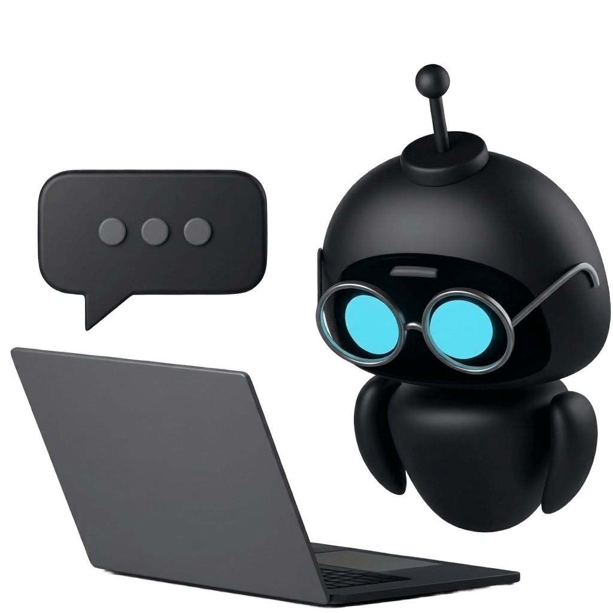
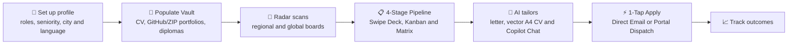
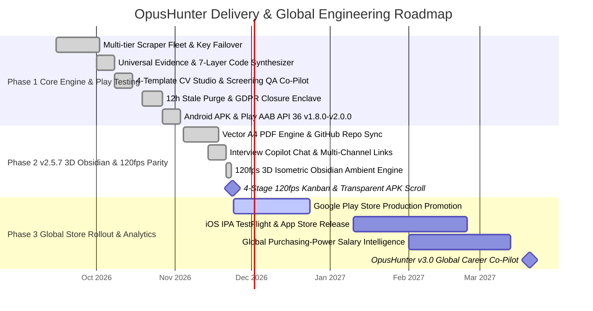
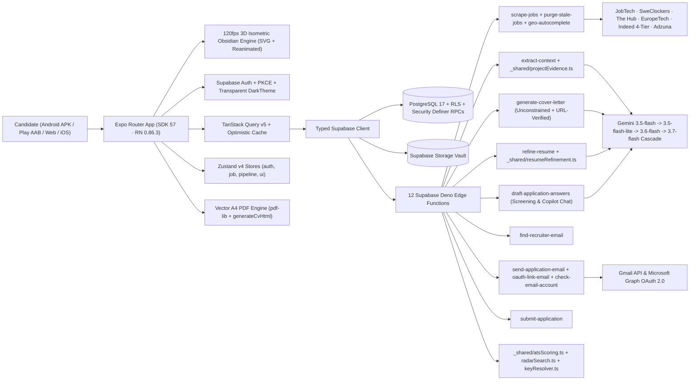

<div align="center">



# OpusHunter

### Your autonomous, evidence-grounded job application co-pilot

**Discover jobs. Tailor applications from your real portfolio & credentials. Apply in one tap.**
<br/>
Built for every profession and global market — Focus is first in Sweden 🇸🇪 and the EU. 

<br/>

<a href="https://github.com/AlexBuildsLTS/OpusHunter-Release/releases/latest"></a>
<a href="https://github.com/AlexBuildsLTS/OpusHunter-Release/releases/latest"></a>
<a href="https://opus-hunter.vercel.app/"></a>
<a href="https://opus-hunter.vercel.app/"></a>

<br/>


<br/><br/>

<a href="https://github.com/AlexBuildsLTS/OpusHunter-Release/releases/tag/v2.5.7">
  
</a>
&nbsp;
<a href="https://opus-hunter.vercel.app/">
  
</a>
&nbsp;


</div>

<br/>

---

## 📑 Contents

- [Why OpusHunter](#-why-opushunter)
- [Built for Every Profession & Country](#-built-for-every-profession--country)
- [Download & Install](#-download--install)
- [How It Works](#-how-it-works)
- [Feature Highlights](#-feature-highlights)
- [Job Sources & Geographic Coverage](#-job-sources--geographic-coverage)
- [Privacy, Control & Fair Access](#-privacy-control--fair-access)
- [Release Notes](#-release-notes)
- [Versioning & Release Policy](#-versioning--release-channel-policy)
- [Roadmap](#-roadmap)
- [Engineering Delivery Roadmap](#-engineering-delivery-roadmap)
- [Architecture & Component Topology](#-architecture--component-topology)
- [Repository Layout](#-repository-layout)
- [Technology Stack](#-technology-stack)
- [Long-Term Vision](#-long-term-vision)
- [FAQ](#-faq)
- [Support & Feedback](#-support--feedback)

---

## 💡 Why OpusHunter

Job hunting today is fragmented: a dozen job boards, scattered documents, browser tabs, spreadsheets, and the same cover letter rewritten fifty times. Most of it is repetition — and generic, unverified applications get filtered out by recruiters and ATS screeners.

**OpusHunter replaces the grind with intelligent, evidence-grounded preparation and dispatch:**

<table>
<tr>
<td width="33%" align="center">

### 🔭

**Discover**
<br/>
Aggregates jobs from Swedish, Nordic, European, and global sources into one clean, SHA-256 deduplicated pipeline.

</td>
<td width="33%" align="center">

### 🧠

**Tailor**
<br/>
Writes cover letters, 1-page vector A4 CVs, screening answers, and recruiter replies grounded in _your real_ work, portfolios, and diplomas — zero invented claims.

</td>
<td width="33%" align="center">

### ⚡

**Apply**
<br/>
Dispatches directly via your linked Gmail or Outlook account with your tailored cover letter and attached CV PDF in one tap.

</td>
</tr>
</table>

> **Controlled execution, always under your command.** You decide what gets generated and what gets sent. OpusHunter never fabricates experience.

---

## 🌍 Built for Every Profession & Country

While OpusHunter includes deep source-code and manifest inspection for software engineers, its **Evidence Intake Hub**, **4-Template Vector A4 CV Studio**, and **Tailored Letter Engine** are architected for **any profession, any industry, and any country**:

| Profession / Field                           | What You Upload to the Vault                                                                            | How OpusHunter Uses Your Evidence                                                                               |
| :------------------------------------------- | :------------------------------------------------------------------------------------------------------ | :-------------------------------------------------------------------------------------------------------------- |
| 💻 **Software & IT**                         | CV, `.zip` code repositories, direct public GitHub repo links, Repomix XML, technical certificates      | Inspects physical manifests, schemas, and 7 architectural layers; matches exact stack requirements to the ad.   |
| 🏗️ **Builders, Construction & Engineering**  | CV, project portfolios, technical drawings/specs (`.pdf`, `.zip`), trade licenses & safety certificates | Highlights delivered projects, site responsibilities, regulatory compliance, and verified trade certifications. |
| ⚖️ **Legal, Finance & Consulting**           | CV, academic degrees, bar/charter credentials, anonymized case or advisory summaries                    | Emphasizes verified qualifications, regulatory domains, analytical rigor, and client outcomes in formal prose.  |
| 🎨 **Design, Creative & Architecture**       | CV, portfolio archives, case studies, software/tool certifications                                      | Connects creative deliverables, tool mastery, and real project briefs to the employer's stated needs.           |
| 🏥 **Healthcare, Education & Public Sector** | CV, diplomas, vocational licenses (`Behörighetsintyg`), training records                                | Anchors applications strictly on verified credentials, issuers, dates, and clinical/educational experience.     |

---

## 📲 Download & Install

<div align="center">

| Platform                     |             Status             |                                                Get it                                                |
| :--------------------------- | :----------------------------: | :--------------------------------------------------------------------------------------------------: |
| 🤖 **Android (APK)**         |    ✅ Available (`v2.5.7`)     | [**Download v2.5.7 APK →**](https://github.com/AlexBuildsLTS/OpusHunter-Release/releases/tag/v2.5.7) |
| 🌐 **Web App**               |        ✅ Live (`v2.5.7`)      |               [**Responsive Desktop & Mobile Web →**](https://opus-hunter.vercel.app/)               |
| ▶️ **Google Play Store**     | 🧪 Internal Testing (`API 36`) |                            Active Play Console `.aab` testing (`Build 257`)                          |
| 🍎 **iOS (App Store / IPA)** |    ✅ Web Live · IPA Ready     |                     [**Open on iOS Safari →**](https://opus-hunter.vercel.app/)                      |

</div>

### Installing the APK on Android

1. Open the [**latest release**](https://github.com/AlexBuildsLTS/OpusHunter-Release/releases/latest) on your Android phone.
2. Under **Assets**, tap the `.apk` file to download it.
3. When prompted, allow your browser or file manager to **install unknown apps** (_Settings → Apps → Special access → Install unknown apps_).
4. Open the downloaded file and tap **Install**.
5. Launch **OpusHunter**, sign in with Google or email, and complete your profile.

> [!TIP]
> **Updating from an earlier build?** Install the new APK directly over the existing app — your profile, Document Vault, and pipeline live in Supabase cloud and stay 100% intact.

> [!NOTE]
> Android may display a standard "Play Protect" prompt for direct APK releases outside the Play Store. Tap **Install anyway** to proceed.

**Requirements:** Android 8.0 (Oreo, API 26) or newer · Internet connection · A Google or email account.

---

## 🔄 How It Works



1. **Configure your profile** — target roles (via dynamic `BalancedChipGrid` recommendations), seniority levels, preferred cities (with GPS lock), and your preferred AI/CV language from **100+ supported languages**.
2. **Populate your Document Vault** — upload your CV (`.pdf` / `.docx`), import public GitHub repositories (`lib/githubRepoSync.ts`) or `.zip` / Repomix XML archives, attach multi-channel live release links (`Play Store`, `App Store`, `Web`, `APK/IPA`), and upload diplomas/certificates.
3. **Run the Job Radar** — fresh listings are harvested across Swedish, Nordic, European, and global feeds, scored deterministically against your verified skills, and deduplicated via SHA-256.
4. **Triage your 4-stage pipeline** — swipe cards in the Discovery Deck, drag across the 4-stage Kanban board (`Discovered · Saved · Applied · Interview`), or filter and sort 500+ roles at 120fps in the Matrix List view.
5. **Tailor, chat & verify** — generate an evidence-grounded native-language cover letter (zero artificial word or token caps), refine a selectable vector A4 CV PDF across 4 templates, or open the blue **Copilot Chat** (`InterviewChatModal.tsx`) for screening answers, recruiter replies, and interview preparation.
6. **Apply in one tap** — send directly via your linked Gmail or Outlook account (`multipart/alternative` HTML + plain text with clickable portfolio links, attached primary CV PDF, and verified certification PDFs), or launch the employer portal with your letter copied to clipboard.

---

## ✨ Feature Highlights

### 🌌 Procedural 120fps 3D Isometric Obsidian Ambient Engine (`components/shared/AnimatedBackground.tsx`)

- **100% Pure-Code Vector SVG + UI-Thread Reanimated 3D Scene**: Zero external video dependencies and instant frame-1 rendering across Desktop Web, Mobile Web, Android APK, and iOS IPA.
- **Standard Mode (`⚡` — Default)**: Full 7.8s isometric studio choreography featuring a matte charcoal-obsidian floor with concentric cyan-emerald telemetry ellipses, a continuous 120fps rotating isometric radar sweep cone, an expanding electric-cyan plasma energy ring, a hovering beveled frosted glass resume tablet with glowing circular progress ring and diagonal cyan laser scan, and an upper-right 3×2 frosted glass card deck whose front row retracts during the scan pulse.
- **Subtle Radar Mode (`»` in Settings Hub)**: Calmer ambient option that keeps the exact same matte obsidian background, concentric isometric rings, and rotating radar sweep while omitting the hovering frosted glass cards and laser scan.
- **Edge-to-Edge Transparent Mobile Top Scroll (`PageContainer.tsx`, `SafeAreaWrapper.tsx`)**: Delegates top floating-header clearance (`FloatingHeaderTopInsetContext`) directly into each screen's `<ScrollView contentContainerStyle>` so scrolling cards glide all the way to the top edge of the display (`y = 0`) behind the floating `LuminousSpinner` mascot and profile avatar with zero horizontal clipping seam.

### 📋 4-Stage 120fps Kanban Board, Matrix List & Copilot Chat (`pipeline.tsx`, `KanbanBoard.tsx`, `InterviewChatModal.tsx`)

- **Streamlined 4-Stage Active Pipeline (`Discovered · Saved · Applied · Interview`)**: Responsive 4-column desktop board that fits cleanly side-by-side with smooth horizontal Web scroll (`overflowX: 'auto'`, `scrollBehavior: 'smooth'`), paired with unified single-bar stage switching on Phone/APK driven directly by the top frosted stat pills (`Total Pipeline`, `Discovered`, `Saved`, `Applied`, `Interview`).
- **High-Volume `500+` Card $O(1)$ Performance Engine**: Shares pre-computed `candidateSkillSet` and $O(1)$ `alignmentByJobId` across Kanban cards and Matrix rows, memoizes per-card tech-chip matches, stabilizes status mutations via `applicationsRef`, and sorts 500+ listings via an $O(N)$ Schwartzian transform.
- **Drag-Click Suppression & 1-Click Blue Copilot Chat**: Dual drag-click suppression ensures dragging or reordering cards never triggers the card detail modal; both Kanban cards and Matrix List rows feature a 1-click electric-blue **Copilot Chat** button (`MessageSquareReply`) and **`Move to Bookmark`** protection (`TagPlus`).

### 📄 AI CV Refiner, 4-Template Vector A4 PDF Studio & Language Pinning (`generateCvHtml.ts`, `generateAtsPdf.ts`, `InlineCvTailorStudio.tsx`)

- Rewrites and condenses your CV around verified vault evidence without fabricating skills or employers, with 2 dedicated **Language Pin Slots** (`SV` / `EN` or any of 100+ languages).
- Choose between **4 executive A4 templates** with genuine cross-platform vector PDF export (`application/pdf` via `pdf-lib` & `expo-print` across Web, Android APK, and iOS IPA):
  1. **Modern Executive** (2-column calibrated navy sidebar, circular photo ring, categorized skill badges)
  2. **Nordic Clean Slate** (Scandinavian 1-column slate banner, 2×2 skill grid, framed project cards)
  3. **Technical Systems** (High-density 1-column engineering layout with monospace stack tags)
  4. **Clean Executive ATS** (Strict linear 1-column parser-first flow with crisp horizontal dividers)

### 🌐 Universal 100+ Language Engine & Symmetrical 3×3 Quick-Access Selector (`candidateLanguages.ts`)

- **Symmetrical 3×3 Quick-Access Matrix**: Instant 1-tap switching across your 9 primary regional languages (`profile.tsx` & `cover-letter/[id].tsx`):
  - 🇸🇪 **Svenska (Swedish)** · 🇬🇧 **English (UK)** · 🇺🇸 **English (US)**
  - 🇩🇪 **Deutsch (German)** · 🇳🇴 **Norsk (Norwegian)** · 🇩🇰 **Dansk (Danish)**
  - 🇫🇮 **Suomi (Finnish)** · 🇳🇱 **Nederlands (Dutch)** · 🇫🇷 **Français (French)**
- **1-Tap 100+ Language Search Drawer**: Instant, search-indexed catalog of 100+ ISO-standard languages with dialect detection, culturally authentic sign-offs, and ATS technical token retention.

### 🧠 Evidence-Grounded AI Cover Letters & Multi-Channel Release Links (`generate-cover-letter`, `projectEvidence.ts`)

- **Your real work leads the story**: Ranks your uploaded projects, direct GitHub repo imports, work history, and diplomas against each job ad with **zero artificial word or token limits**.
- **Verified Multi-Channel Release Proof**: Automatically cites and verifies per-project live distribution links (`Play Store`, `App Store`, `Web`, `APK/IPA Package`, and GitHub repo URLs) with strict anti-cross-contamination ownership checks (`projectReleaseUrlMap`).
- **Three distinct strategies & five formality profiles**: Switch between _ATS Keyword Mirroring_, _Achievement Amplifier_, and _Insider Narrative_ across _Professional_, _Formal Corporate_, _Technical Deep-Dive_, _Executive Brief_, or _Storytelling_ tones.

### 🎯 Deterministic ATS Knockout Math, Red `MISMATCHED` Badges & `Sync Radar` Auto-Purge (`atsScoring.ts`, `radarSearch.ts`, `purge-stale-jobs`)

- **Deterministic Knockout Gating**: `60%` verified skill match + `25%` structured requirements + `15%` articulation, with multiplicative title/seniority gating (`gated_score = raw_score * tech_ratio`). When required core criteria exist and candidate overlap is zero, total score is `0` and displays a crisp red **`MISMATCHED`** badge with `ShieldAlert` (never clamping to a false `1% ATS`).
- **Automated & On-Demand `Sync Radar` Hygiene**: Verifies upstream liveness across JobTech (`GET /ad/{id}`), The Hub (`/jobs/single/{id}`), SweClockers, and employer web pages, and automatically purges dead, out-of-market, or non-bookmarked `0%` `MISMATCHED` listings while strictly protecting `TagPlus`-bookmarked roles and active applications (`applied`, `interview`, `offer`).

---

## 🌐 Job Sources & Geographic Coverage

| Region / Market              |           Status           | Primary Sources & Integration Method                                                                                                                                                                                                                                                                                                                                                        | Focus Areas                                                               |
| :--------------------------- | :------------------------: | :------------------------------------------------------------------------------------------------------------------------------------------------------------------------------------------------------------------------------------------------------------------------------------------------------------------------------------------------------------------------------------------ | :------------------------------------------------------------------------ |
| 🇸🇪 **Sweden**                |   ✅ **Live & Hardened**   | • **JobTech Open API (Arbetsförmedlingen)**: Platsbanken public feed (`jobtech.ts`)<br/>• **SweClockers Jobb**: Direct-mailto IT, systems & engineering board (`sweclockers.ts`)<br/>• **The Hub Sweden**: Direct startup & scale-up REST API (`thehub.ts`)<br/>• **Indeed Multi-Tier Radar**: 4-gateway fallback (`indeed.ts`)<br/>• **Adzuna & LinkedIn**: (`adzuna.ts`)            | All professions, IT/tech, engineering, healthcare, trades & public sector |
| 🇪🇺 **European & Remote Tech**|   ✅ **Live & Hardened**   | • **Europe Tech Feed (`europeTech.ts`)**: Pan-European & remote tech feeds with target-country market filtering (`resolveTargetRegionScope`)<br/>• **The Hub Nordics**: Startup & scale-up feeds across SE, NO, DK, FI<br/>• **Adzuna 19-Country Index & Indeed Multi-Tier**: Regional & international listings                                                                               | Software, cloud, AI/ML, product, engineering & remote European roles      |
| 🌍 **Nordics, DACH & Global**|   ✅ **Live / Scaling**    | • **Adzuna Multi-Market & JSearch / RapidAPI Cascade**: Coverage across NO, DK, FI, DE, AT, CH, NL, GB, US & remote global markets                                                                                                                                                                                                                                                          | Borderless remote work, relocation & global talent mobility               |

---

## 🔒 Privacy, Control & Fair Access

- **Human-in-the-loop always.** Nothing is emailed or marked as applied without your explicit action.
- **Your email, your identity.** Gmail and Outlook are linked via official OAuth 2.0 PKCE (`oauth-link-email`) with automatic token health checks (`check-email-account`).
- **Row-Level Security (RLS) & Hardened RPCs.** Every PostgreSQL table and storage bucket enforces `auth.uid() = user_id` isolation, and all `SECURITY DEFINER` RPCs (`recalculate_user_skills`, `delete_my_account`) pin `SET search_path = public`.
- **PIN & Biometric BYOK Security Vault.** Store personal Gemini, RapidAPI, or Hunter.io keys protected by hardware-backed secure storage, Face ID / Biometrics, and Argon2/Bcrypt PIN verification.

---

## 📝 Release Notes

### 🚀 v2.5.7 (Current Release — Build 257 · November 23, 2026)

> Full release & APK download: [**`GitHub Release v2.5.7 →`**](https://github.com/AlexBuildsLTS/OpusHunter-Release/releases/tag/v2.5.7)

- **Edge-to-Edge Transparent Mobile Top Scroll (`PageContainer.tsx`, `SafeAreaWrapper.tsx`, `rules.tsx`)**:
  - Eliminated the hard horizontal top clipping seam below the floating mascot and avatar on Android APK, iOS IPA, and Mobile Web via `FloatingHeaderTopInsetContext` and automatic `<ScrollView contentContainerStyle>` padding injection so cards glide smoothly to the top display edge (`y = 0`).
- **Streamlined 4-Stage Pipeline & Kanban Board (`pipeline.tsx`, `KanbanBoard.tsx`)**:
  - Removed the redundant 5th `Pass` (`rejected`) column and top `Passed` counter pill; sized the 4 active columns (`Discovered · Saved · Applied · Interview`) responsively (`desktopColumnWidth`) with smooth horizontal Web scroll (`overflowX: 'auto'`, `scrollBehavior: 'smooth'`).
  - Removed the duplicate mobile stage strip (`mobileTabBar`) in `KanbanBoard.tsx`, reclaimed `44px` of card height on Phone/APK, unified stage switching with the top modern frosted stat pills (`activeStageFilter`), locked frame-1 mobile column width to `measuredBoardWidth`, and added dual drag-click suppression so dragging cards never opens the detail modal.
- **Matrix List 1-Click Blue Copilot Chat & `Move to Bookmark` (`pipeline.tsx`)**:
  - Replaced the redundant row-level cover-letter icon on Matrix List rows with the 1-click blue **Copilot Chat** button (`MessageSquareReply`), added amber `TagPlus` bookmark badges on bookmarked rows, and added **`Move to Bookmark` / `Remove from Bookmark`** + **`Open Copilot Chat`** to the **Job Options** context modal.
- **High-Volume `500+` Card 120fps Performance Engine (`pipeline.tsx`, `KanbanBoard.tsx`)**:
  - Shared $O(1)$ pre-computed `alignmentByJobId` and `candidateSkillSet` across all cards, memoized per-card tech-chip matching (`visibleTechTags`), stabilized `updateStatus` via `applicationsRef`, replaced 40-layer per-card Web `backdropFilter` blur with a fast `0.90` obsidian card surface, and upgraded `filteredApplications` sorting to an $O(N)$ Schwartzian transform.
- **Red `MISMATCHED` Badge, `Sync Radar` Auto-Purge & Reanimated Web Easing Parity (`KanbanBoard.tsx`, `SwipeDeck.tsx`, `index.tsx`, `pipeline.tsx`, `purge-stale-jobs`, `auth.tsx`, `ProfileSetupWizard.tsx`)**:
  - Standardized `0%` core-stack mismatches to render a red **`MISMATCHED`** badge with `ShieldAlert` (never `1% ATS`), wired **`Sync Radar`** to automatically delete non-bookmarked mismatched roles, and resolved Reanimated Web `WebEasings` layout transitions with zero console warnings.

### ⚡ v2.5.6 (Build 256 — November 23, 2026)

> Full release & APK download: [**`GitHub Release v2.5.6 →`**](https://github.com/AlexBuildsLTS/OpusHunter-Release/releases/tag/v2.5.6)

- **Procedural 120fps 3D Isometric Obsidian Ambient Engine (`AnimatedBackground.tsx`, `settings/index.tsx`)**: Pure SVG + Reanimated UI-thread 3D isometric scene with **Standard (`⚡`)** mode (hovering frosted glass resume tablet, diagonal cyan laser scan, expanding plasma ring, retracting 3×2 glass card deck) and **Subtle (`»`)** radar mode.
- **Expo Router SDK 57 Transparent `DarkTheme` & Web Cold-Boot Hardening (`app/_layout.tsx`, `useAuthRedirect.ts`, `authStore.ts`, `supabase.ts`, `+html.tsx`, `vercel.json`)**: Permanently mounted `<Stack>` with transparent `DarkTheme`, bounded startup auth timeouts (`4.5s`/`5.0s`), non-blocking fonts, and immutable Vercel edge caching.
- **Whole-App Frosted Obsidian Surface Parity (`getFrostedSurfaceStyle`), Single-Line Mobile KPI Cards & `BalancedChipGrid` (`theme.ts`, `BalancedChipGrid.tsx`, `roleRecommendations.ts`)**: Unified frosted obsidian surfaces across all screens, zero-wrap tabular mobile KPI cards (`1,143`, `1,016`), and dynamic 2-up/solo chip packing.

### ⚡ v2.5.0 – v2.5.5 (Builds 250–255 — November 2026)

> Full releases index: [**`All GitHub Releases →`**](https://github.com/AlexBuildsLTS/OpusHunter-Release/releases)

- **Cross-Platform Vector A4 PDF CV Studio (`generateAtsPdf.ts`, `generateCvHtml.ts`, `InlineCvTailorStudio.tsx`)**, **Direct Public GitHub Repository Sync (`githubRepoSync.ts`)**, **Multi-Channel Project Release Proof Icons (`Play Store`, `App Store`, `Web`, `APK/IPA`)**, **Interactive Interview & Recruiter Reply Copilot Chat (`InterviewChatModal.tsx`)**, and **Live Animated `LuminousSpinner` Mascot**.

### ⚡ v1.8.0 – v1.0.0 Foundation Releases (September – October 2026)

- Modular Radar Scan Console (`ActiveTargetCard.tsx`), 2-Step GDPR Account Closure Enclave (`delete_my_account` RPC), 3-Tier Verified Skill Intelligence Tree (`profile.tsx`), Per-`keyId` 429 Gemini Cascade (`gemini.ts`), Amber `TagPlus` Bookmark Protection & 12-Hour Stale Listing Purge (`purge-stale-jobs`), Flagship Project Pinning, 7-Layer Codebase Architecture Synthesis (`extract-context`), and Multi-Tier Job Radar (`JobTech`, `SweClockers`, `The Hub`, `Indeed`, `Adzuna`, `EuropeTech`).

---

## 🏷️ Versioning & Release Channel Policy

| Channel                      | Artifact                            | Target Audience                     | Distribution                                                                    |
| :--------------------------- | :---------------------------------- | :---------------------------------- | :------------------------------------------------------------------------------ |
| **Release (Current)**        | `v2.5.7` Signed APK (`Build 257`)   | Candidates, power users & testers   | [GitHub Releases](https://github.com/AlexBuildsLTS/OpusHunter-Release/releases) |
| **Google Play Store**        | `.aab` (`API 36` · `versionCode 257`)| Android Play Store users            | Google Play Console                                                             |
| **iOS (Web Live / IPA)**     | `.ipa` (`buildNumber "257"`) & Web  | iOS Safari & TestFlight users       | [Live Web App](https://opus-hunter.vercel.app/) & TestFlight                    |
| **Web Application**          | Responsive Desktop & Mobile Web     | Desktop & mobile browser users      | [https://opus-hunter.vercel.app/](https://opus-hunter.vercel.app/)              |

---

## 🗺️ Roadmap

```mermaid
flowchart LR
    subgraph Phase1["🟢 Phase 1: Core Engine, 4-Template A4 PDF & Multi-Source Radar (v1.0 – v2.0 - Shipped)"]
        A1["Android APK, Play AAB (API 36) & Web Parity"]
        A2["Symmetrical 3x3 Language Matrix (100+ Languages)"]
        A3["4-Template Vector A4 PDF CV Studio & Unconstrained Cover Letters"]
        A4["Direct GitHub Repo Sync & 7-Layer Code Synthesizer"]
        A5["Multi-Source Radar (JobTech, SweClockers, The Hub, Indeed, Adzuna, EuropeTech)"]
        A6["GDPR Closure Enclave & Per-Key 429 Gemini Cascade"]
    end
    subgraph Phase2["🟢 Phase 2: 120fps 3D Obsidian Engine, 4-Stage Kanban & Copilot Chat (v2.5.7 - Current)"]
        B1["Procedural 120fps 3D Isometric Obsidian Ambient Engine (Standard & Subtle Modes)"]
        B2["Streamlined 4-Stage Kanban & Matrix List with O(1) 500+ Card Performance"]
        B3["Edge-to-Edge Transparent Mobile Top Scroll & Frosted Obsidian Surfaces"]
        B4["Interactive Interview & Recruiter Reply Copilot Chat (InterviewChatModal)"]
        B5["Red MISMATCHED Knockout Badges & Sync Radar Auto-Purge"]
        B6["Symmetrical BalancedChipGrid & Dynamic Multi-User Role Recommendations"]
    end
    subgraph Phase3["🟣 Phase 3: Global Store Rollout & Outcome Analytics (v2.6+ / v3.0)"]
        C1["Google Play Public Store Promotion & iOS App Store Rollout"]
        C2["Purchasing-Power Adjusted Multi-Currency Salary Intelligence"]
        C3["Voice & Live Simulation Interview Practice Co-Pilot"]
        C4["Application Outcome & Conversion Analytics Dashboard"]
    end
    Phase1 --> Phase2 --> Phase3
```



### 🟢 Shipped & Live in `v2.5.7` (`Build 257` — Current)

- [x] **Edge-to-Edge Transparent Mobile Top Scroll (`PageContainer.tsx`, `SafeAreaWrapper.tsx`)**: Zero top horizontal clipping seam below the floating mascot and avatar on Android APK, iOS IPA, and Mobile Web
- [x] **Streamlined 4-Stage Pipeline & 120fps Kanban Board (`pipeline.tsx`, `KanbanBoard.tsx`)**: Responsive 4-column desktop layout (`Discovered · Saved · Applied · Interview`) with smooth horizontal Web scroll, single-bar mobile stage switching driven by the top frosted stat pills, `measuredBoardWidth` frame-1 alignment, and drag-click suppression
- [x] **High-Volume `500+` Card $O(1)$ Performance Engine**: Shared `alignmentByJobId` and `candidateSkillSet`, memoized tech-chip matching, `applicationsRef` mutation stability, and $O(N)$ Schwartzian sorting
- [x] **Matrix List 1-Click Blue Copilot Chat & `Move to Bookmark` (`pipeline.tsx`, `InterviewChatModal.tsx`)**: Instant role-contextual Copilot Chat from both Kanban cards and Matrix List rows, plus `Move to Bookmark` in Job Options
- [x] **Red `MISMATCHED` Knockout Badges & `Sync Radar` Auto-Purge (`atsScoring.ts`, `purge-stale-jobs`)**: Honest red `MISMATCHED` badges with `ShieldAlert` for `0%` core-stack mismatches and automatic purge on `Sync Radar`
- [x] **Procedural 120fps 3D Isometric Obsidian Ambient Engine (`AnimatedBackground.tsx`)**: Pure SVG + Reanimated UI-thread 3D scene with Standard (`⚡`) hovering glass cards & laser scan and Subtle (`»`) radar mode
- [x] **Expo Router SDK 57 Transparent `DarkTheme` & Fast Web Cold-Boot (`app/_layout.tsx`, `authStore.ts`, `vercel.json`)**: Zero white-screen flash, permanently mounted root `<Stack>`, bounded startup auth timeouts, and Reanimated Web `WebEasings` compliance
- [x] **Whole-App Frosted Obsidian Surfaces (`getFrostedSurfaceStyle`), Zero-Wrap Mobile KPI Cards & `BalancedChipGrid` (`theme.ts`, `BalancedChipGrid.tsx`, `roleRecommendations.ts`)**
- [x] **Cross-Platform Vector A4 PDF CV Studio (`generateAtsPdf.ts`, `generateCvHtml.ts`, `InlineCvTailorStudio.tsx`)** across all 4 executive templates (`application/pdf` on Web, Android APK & iOS IPA) with language pinning
- [x] **Direct Public GitHub Repository Sync (`githubRepoSync.ts`) & Multi-Channel Release Proof Badges (`Play Store`, `App Store`, `Web`, `APK/IPA`)**
- [x] **Universal 100+ Language AI Engine (`candidateLanguages.ts`)** with symmetrical 3×3 quick-access matrix and searchable 100+ language catalog
- [x] **1-Tap Gmail & Outlook `multipart/alternative` Dispatch (`send-application-email`, `oauth-link-email`, `check-email-account`)** with CV + Certification PDF attachments

---

## 📅 Engineering Delivery Roadmap



### Detailed Milestone Breakdown

| Version                   |  Channel   |        Release Date       | Core Deliverables & Milestones                                                                                                                                                                                                                                                                                                                                                                                                                                                     |
| :------------------------ | :--------: | :-----------------------: | :--------------------------------------------------------------------------------------------------------------------------------------------------------------------------------------------------------------------------------------------------------------------------------------------------------------------------------------------------------------------------------------------------------------------------------------------------------------------------------- |
| **v1.0.0 – v1.7.5**       |  **Beta**  |   **Sept – Oct 25, 2026** | Multi-tier Job Radar (`JobTech`, `SweClockers`, `The Hub`, `Indeed`, `Adzuna`), 7-layer codebase synthesizer (`extract-context`), 4-template CV Studio, Flagship Project Pinning, `TagPlus` bookmark lock, and 12-hour stale listing purge (`purge-stale-jobs`).                                                                                                                                                                                                                   |
| **v1.8.0 – v2.0.0**       | **Release**|  **Oct 27 – Nov 3, 2026** | Modular Radar Scan Console (`ActiveTargetCard.tsx`), 2-step GDPR Account Closure Enclave (`delete_my_account` RPC), 3-tier Verified Skill Intelligence Hierarchy (`profile.tsx`), per-`keyId` 429 Gemini cascade (`gemini.ts`), Android API 36 compliance, and universal multi-user skill recalculation (`recalculate_user_skills`).                                                                                                                                               |
| **v2.5.0 – v2.5.5**       | **Release**|   **Nov 20 – 22, 2026**   | Cross-platform vector A4 PDF CV engine (`generateAtsPdf.ts`), direct public GitHub repository sync (`githubRepoSync.ts`), multi-channel project release links (`Play Store`, `App Store`, `Web`, `APK/IPA`), interactive Interview & Recruiter Reply Copilot Chat (`InterviewChatModal.tsx`), live `LuminousSpinner` mascot, and `europeTech.ts` adapter.                                                                                                                                 |
| **v2.5.6 (`Build 256`)**  | **Release**|   **November 23, 2026**   | Procedural 120fps 3D Isometric Obsidian Ambient Engine (`AnimatedBackground.tsx` — Standard `⚡` & Subtle `»` modes), Expo Router SDK 57 transparent `DarkTheme` cold-boot hardening, candidate-first `/auth` hero with dual `SIGN IN` / `SIGN UP` header & APK button symmetry, whole-app `getFrostedSurfaceStyle` parity, single-line mobile KPI cards, and `BalancedChipGrid`.                                                                                                         |
| **v2.5.7 (`Build 257`)**  | **Current**|   **November 23, 2026**   | **Edge-to-Edge Transparent Mobile Top Scroll, 4-Stage 120fps Kanban/Pipeline Engine & `Sync Radar` Mismatch Auto-Purge**: `FloatingHeaderTopInsetContext` + `SafeAreaWrapper` `<ScrollView>` injection eliminating top clipping seams on APK/IPA; 4-stage Kanban (`Discovered · Saved · Applied · Interview`) with single-bar mobile stage pills, `measuredBoardWidth` alignment & drag-click suppression; Matrix List blue Copilot Chat & `Move to Bookmark`; red `MISMATCHED` badges & auto-purge. |

---

## 🏗️ Architecture & Component Topology



---

## 📂 Repository Layout

```text
OpusHunter/
├── app/
│   ├── _layout.tsx                         Root layout, transparent DarkTheme, 3D AnimatedBackground & auth guard
│   ├── +html.tsx                           Web root HTML, preconnected fonts & dark color-scheme meta
│   ├── index.tsx                           Root entry & route dispatcher
│   ├── (auth)/
│   │   ├── _layout.tsx                     Auth stack layout
│   │   ├── auth.tsx                        3D commercial hero, 01–04 HUD callouts, Sign In / Sign Up & Google OAuth
│   │   ├── onboarding.tsx                  Visual capability tour
│   │   └── profile-setup.tsx               5-step guided profile setup route
│   ├── (tabs)/
│   │   ├── _layout.tsx                     Universal AdaptiveLayout navigation shell
│   │   └── (dashboard)/
│   │       ├── index.tsx                   Discover dashboard, single-line KPI cards & SwipeDeck
│   │       ├── pipeline.tsx                4-stage Kanban board, Matrix List, Copilot Chat & Quick Apply
│   │       ├── rules.tsx                   Radar Scan Console & Radar Parameters editor
│   │       ├── admin/                      Kernel command center (index.tsx, users.tsx, api-keys.tsx)
│   │       └── settings/                   Settings Hub (index.tsx), Profile (profile.tsx), Document Hub
│   │                                       (documents.tsx, DocumentUploader.tsx), API & Security Vault
│   │                                       (vault.tsx), Billing (billing.tsx) & Email Linking (email-linking.tsx)
│   ├── apply/[id].tsx                      Application preparation & 1-tap dispatch screen
│   ├── cover-letter/[id].tsx               Cover letter studio, 100+ language switcher & regeneration
│   └── job/[id].tsx                        Job specification & tailored synthesis screen
├── components/
│   ├── jobcardsetup/                       SwipeDeck, KanbanBoard, InterviewChatModal, InlineCvTailorStudio,
│   │                                       ActiveTargetCard, RadarRulesEditor, ProfileSetupWizard, LetterStylePicker
│   ├── layout/                             AdaptiveLayout & FloatingHeaderTopInsetContext PageContainer
│   ├── shared/                             AnimatedBackground (120fps 3D Isometric Engine), SafeAreaWrapper,
│   │                                       ProfileDropdown, CandidateFieldPickers, MicroArcOverlay, RoleEmblem
│   └── ui/                                 GlassCard, BalancedChipGrid, LuminousSpinner, Modal, Button,
│                                           Badge, Chip, Input, LoadingOverlay, Skeleton, Stepper, Toast, Typography
├── constants/                              theme.ts (getFrostedSurfaceStyle), animations.ts & letterProfiles.ts
├── hooks/                                  useAdaptiveLayout, useAuthRedirect, useJobs, useGmail, useOutlook
├── lib/                                    generateAtsPdf, generateCvHtml, githubRepoSync, roleRecommendations,
│                                           candidateLanguages, listingSummary, geo, seniority, skills, supabase
├── stores/                                 authStore, jobStore, coverLetterStore, usePipelineStore, uiStore
├── types/                                  database.types.ts, app.types.ts, emailLinking.types.ts
└── supabase/
    ├── sql/                                PostgreSQL 17 schema migrations, RLS policies & SECURITY DEFINER RPCs
    └── functions/                          12 Deno Edge Functions + _shared/
        ├── _shared/                        atsScoring, gemini, geo, keyResolver, projectEvidence, radarSearch,
        │                                   resumeRefinement, emailTokenManager, languagePreference, rateLimit, cors
        ├── check-email-account/            Verifies live Gmail & Microsoft Graph OAuth refresh token health
        ├── draft-application-answers/      Screening question & Interview Copilot Chat engine (text & screenshots)
        ├── extract-context/                CV, diploma, GitHub repo & ZIP/Repomix 7-layer portfolio analyzer
        ├── find-recruiter-email/           Hunter.io + domain & listing description recruiter email resolver
        ├── generate-cover-letter/          Unconstrained 100+ language cover-letter engine with URL ownership guard
        ├── geo-autocomplete/               European & global city autocomplete
        ├── oauth-link-email/               Platform-aware Gmail & Outlook OAuth 2.0 PKCE code exchange
        ├── purge-stale-jobs/               Automated & on-demand liveness verification + 0% MISMATCHED purge
        ├── refine-resume/                  Evidence-grounded 1-page CV refiner
        ├── scrape-jobs/                    Multi-source job radar (jobtech, sweclockers, thehub, europeTech, indeed, adzuna)
        ├── send-application-email/         Direct Gmail API & Microsoft Graph multipart/alternative dispatcher
        └── submit-application/             Application record & status persistence handler
```

---

## 🛠️ Technology Stack

| Domain                     | Technology                                                                 | Purpose                                                                                                       |
| -------------------------- | -------------------------------------------------------------------------- | ------------------------------------------------------------------------------------------------------------- |
| **Mobile & Web Framework** | Expo SDK `~57.0.28` / React Native `0.86.3` / React `19.2.3`               | Cross-platform native builds for Android APK (`API 36`), iOS IPA, and Desktop/Mobile Web.                     |
| **Language & Validation**  | TypeScript `~6.0.3` + Zod `^4.6.5`                                         | End-to-end compile-time and runtime schema validation across client and Deno edge functions.                  |
| **Navigation**             | Expo Router `~57.0.26` (`ThemeProvider` Transparent `DarkTheme`)           | File-based typed routing (`Href`), deep linking, adaptive sidebar/floating tab shells, and instant dark boot. |
| **Animation & 3D Engine**  | Reanimated `4.5.1` + Worklets `0.10.1` + Gesture Handler `~2.32.0` + SVG   | 120fps UI-thread 3D isometric ambient engine, SwipeDeck physics, and Kanban drag-and-drop.                    |
| **Styling & Surfaces**     | NativeWind `^4.2.5` + `constants/theme.ts` (`getFrostedSurfaceStyle`)      | Unified frosted obsidian glass surfaces with high-contrast cyan, emerald, and blue accents.                   |
| **State & Caching**        | TanStack Query `^5.28.0` + Zustand `^4.5.2`                                | Optimistic 4-stage pipeline updates, query deduplication, and persistent client state.                        |
| **Backend & Database**     | Supabase (`@supabase/supabase-js` `^2.115.0` · PostgreSQL 17 + RLS + RPCs) | Row-level security, realtime telemetry channels, and hardened `SECURITY DEFINER` RPCs.                        |
| **Serverless Runtime**     | Deno (12 Supabase Edge Functions + `_shared/`)                             | Isolated serverless compute for scraping, archive unpacking, PDF/DOCX parsing, and AI synthesis.              |
| **AI Inference Cascade**   | Google Gemini (`3.5-flash` → `3.5-flash-lite` → `3.6-flash` → `3.7-flash`) | Per-`keyId` isolated multi-model, multi-key failover for cover letters, CV refinement, and Copilot Chat.      |
| **Vector PDF Studio**      | `pdf-lib` `^1.17.1` + `expo-print` `~57.0.2` + `generateAtsPdf.ts`         | Cross-platform selectable vector A4 PDF and 4-template HTML/PDF resume rendering across Web, APK, and IPA.    |

---

## 🔭 Long-Term Vision

OpusHunter is built to be **the universal operating system for career mobility** — from your first uploaded credential to your signed offer, in any profession and any country.

| Horizon                            | Goal                                                                                                                                                               |
| ---------------------------------- | ------------------------------------------------------------------------------------------------------------------------------------------------------------------ |
| 🧰 **Universal Portfolio Proof**   | Let anyone — software engineer, builder, architect, lawyer, nurse, or designer — turn real work samples, drawings, and diplomas into undeniable application proof. |
| 🌐 **Borderless Polyglot Search**  | Search jobs in one country and apply in the employer's native language with culturally accurate CVs and cover letters across 100+ languages.                       |
| 🤝 **Interview Co-Pilot**          | Role-specific interview preparation, recruiter reply drafting, and technical Q&A grounded in the job ad and your own portfolio (`InterviewChatModal.tsx`).         |
| 🏫 **Schools, Trades & Bootcamps** | Help graduates and apprentices turn vocational diplomas (`Yrkeshögskola`, trade certificates, university degrees) into high-converting applications.               |
| 🔐 **Trust by Design**             | Always human-approved, zero hallucinated claims, and transparent about how every application is sent.                                                              |

---

## ❓ FAQ

<details>
<summary><b>Is OpusHunter free? What are the limits?</b></summary>
<br/>
The core app is open to test with generous AI generation allowances. Tier limits for member and premium tiers are actively under evaluation and will not be finalized until full platform stability is achieved. Administrator accounts operate with zero limits. Power users can attach their personal Gemini, RapidAPI, or Hunter.io keys via the PIN & Biometric encrypted BYOK vault.
</details>

<details>
<summary><b>How do Sync Radar and the 12-hour listing cleanup work?</b></summary>
<br/>
OpusHunter runs an automated background hygiene routine every 12 hours (and on-demand whenever you tap <b>Sync Radar</b> in the Pipeline) that verifies live status against upstream providers (JobTech <code>GET /ad/{id}</code>, The Hub <code>/jobs/single/{id}</code>, and direct HTTP probes for 404/410) and automatically purges dead, out-of-market, or non-bookmarked <code>0%</code> <b>MISMATCHED</b> listings. <b>Crucially, active applications (<code>applied</code>, <code>interview</code>, <code>offer</code>), roles with generated cover letters, and any listing pinned with the amber <code>TagPlus</code> bookmark lock (<code>Move to Bookmark</code>) are strictly immune and permanently preserved.</b>
</details>

<details>
<summary><b>Which languages can it write in? How does Quick Access work?</b></summary>
<br/>
Over 100+ native languages are supported via the Google Gemini cascade, with culturally appropriate greetings and formal sign-offs. In your profile and letter editor, a symmetrical 3×3 quick-access matrix gives you instant 1-tap switching between your 9 primary languages (🇸🇪 Swedish, 🇬🇧 English UK, 🇺🇸 English US, 🇩🇪 German, 🇳🇴 Norwegian, 🇩🇰 Danish, 🇫🇮 Finnish, 🇳🇱 Dutch, 🇫🇷 French). A top-right corner switcher opens the full searchable 100+ language drawer with instant cloud sync.
</details>

<details>
<summary><b>Will it apply to jobs without asking me?</b></summary>
<br/>
No. Controlled automation, not blind bots. Every application and email requires your explicit confirmation. OpusHunter prepares everything — you review and approve.
</details>

<details>
<summary><b>Does the AI make things up about me?</b></summary>
<br/>
No. Cover letters, refined CVs, and Copilot Chat answers are strictly grounded in your verified evidence ledger (CV, uploaded projects, GitHub repositories, portfolios, trade licenses, and diplomas). If it isn't in your vault, it isn't in your application.
</details>

<details>
<summary><b>How do I get the latest Android APK or use the Web App?</b></summary>
<br/>
OpusHunter <code>v2.5.7</code> (<code>Build 257</code>, Android SDK API 36) is available right now as a signed Android APK on the official <a href="https://github.com/AlexBuildsLTS/OpusHunter-Release/releases/tag/v2.5.7">GitHub Releases</a> page and live on Desktop & Mobile Web at <a href="https://opus-hunter.vercel.app/">opus-hunter.vercel.app</a> while Google Play Console internal testing progresses toward public Store promotion.
</details>

<details>
<summary><b>Is OpusHunter only for software developers?</b></summary>
<br/>
No. OpusHunter is built for every profession: builders/construction, legal, finance, healthcare, education, design, engineering, and trades. While software developers can import GitHub repositories, code archives, and Repomix XML, any professional can upload CVs, portfolios, diplomas, and credentials.
</details>

---

## 💬 Support & Feedback

Found a bug or have an idea? Your feedback directly shapes the roadmap.

- 🐞 **Report a bug** → [Open an issue](https://github.com/AlexBuildsLTS/OpusHunter-Release/issues/new)
- 💡 **Suggest a feature** → [Start a discussion](https://github.com/AlexBuildsLTS/OpusHunter-Release/issues/new)
- ⭐ **Like OpusHunter?** Star the repository to follow new releases!

---

<div align="center">


**OpusHunter** — Stop applying harder. Start applying smarter.

<sub>© 2026 OpusHunter (`v2.5.7` · `Build 257`). All rights reserved. Made in Sweden 🇸🇪</sub>

</div>
