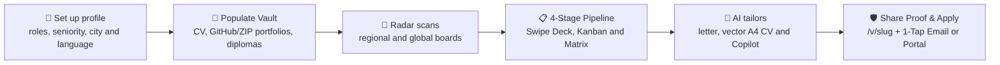
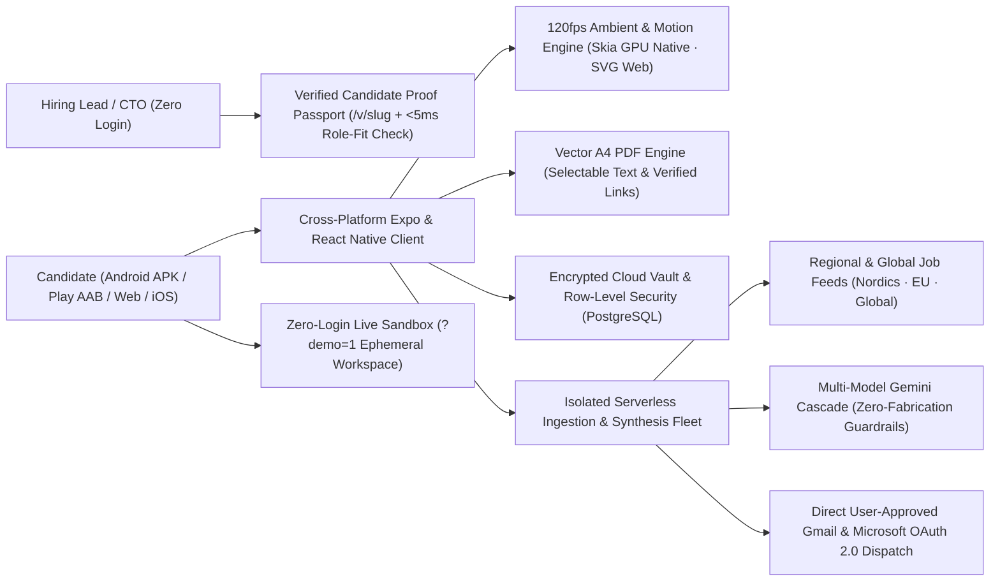

# OpusHunter

### Your autonomous, evidence-grounded job application & verified proof co-pilot

**Discover jobs. Tailor applications from your real portfolio & credentials. Share verifiable proof in one click.**
 
Built for every profession and global market — perfected first in Sweden 🇸🇪 and the Nordics.

 

 

  

&nbsp;

&nbsp;

&nbsp;

 

---

## 📑 Contents

- [Why OpusHunter](#-why-opushunter)
- [Try It Instantly — Zero-Login Live Sandbox](#-try-it-instantly--zero-login-live-sandbox)
- [Built for Every Profession & Country](#-built-for-every-profession--country)
- [Download & Install](#-download--install)
- [How It Works](#-how-it-works)
- [Feature Highlights](#-feature-highlights)
- [Job Sources & Geographic Coverage](#-job-sources--geographic-coverage)
- [Privacy, Security & Fair Access](#-privacy-security--fair-access)
- [Release Notes](#-release-notes)
- [Versioning & Release Policy](#-versioning--release-channel-policy)
- [Roadmap](#-roadmap)
- [High-Level System Architecture](#-high-level-system-architecture)
- [Technology Stack](#-technology-stack)
- [Long-Term Vision](#-long-term-vision)
- [FAQ](#-faq)
- [Support & Feedback](#-support--feedback)

---

## 💡 Why OpusHunter

Job hunting today is broken in both directions: candidates waste hours rewriting the same CV across dozens of tabs, while hiring leads drown in identical-looking static PDFs filled with unverified buzzwords.

**OpusHunter replaces the grind with deterministic role matching, zero-hallucination tailoring, and shareable working proof:**

<table>
<tr>
<td width="25%" align="center">

### 🔭

**Discover**
 
Aggregates live roles across Swedish, Nordic, European, and global boards into one SHA-256 deduplicated pipeline.

</td>
<td width="25%" align="center">

### 🧠

**Tailor**
 
Synthesizes cover letters, 1-page vector A4 CVs, screening answers, and interview prep strictly from _your real_ portfolio & diplomas.

</td>
<td width="25%" align="center">

### 🛡️

**Prove**
 
Publishes a zero-login **Verified Candidate Proof Page** (`/v/<slug>`) + 4-line CTO pitch so hiring engineers see shipped proof in 2 seconds.

</td>
<td width="25%" align="center">

### ⚡

**Apply**
 
Dispatches directly from your linked Gmail or Outlook account with your tailored letter and vector CV PDF in one tap.

</td>
</tr>
</table>

> **Controlled execution, always under your command.** You decide what gets generated, published, and sent. OpusHunter never fabricates experience.

---

## 🟢 Try It Instantly — Zero-Login Live Sandbox

Want to experience the full platform in 2 seconds before creating an account? Launch the **Live Interactive Multi-Persona Career Sandbox** directly in your browser — no sign-up required:

| Sandbox Discipline                  | Candidate Persona                                                    |                             1-Click Launch                              |                            Public Proof Passport                            |
| :---------------------------------- | :------------------------------------------------------------------- | :---------------------------------------------------------------------: | :-------------------------------------------------------------------------: |
| 💻 **Cloud & Full-Stack Systems**   | **Erik Lindqvist** (`TypeScript · React Native · Go · K8s · AWS`)    |   [**Launch `?demo=1` →**](https://opus-hunter.vercel.app/?demo=1)      |  [**`/v/erik-lindqvist` →**](https://opus-hunter.vercel.app/v/erik-lindqvist)  |
| 📊 **Data Science & ML Platform**   | **Sofia Bergström** (`Python · PyTorch · BigQuery · dbt · Spark`)    | [**Launch `?demo=data` →**](https://opus-hunter.vercel.app/?demo=data)  | [**`/v/sofia-bergstrom` →**](https://opus-hunter.vercel.app/v/sofia-bergstrom) |
| 🎨 **Product Design & UX Systems**  | **Lukas Holm** (`Figma · Design Systems · WCAG 2.2 AA · Research`)   | [**Launch `?demo=product` →**](https://opus-hunter.vercel.app/?demo=product) |    [**`/v/lukas-holm` →**](https://opus-hunter.vercel.app/v/lukas-holm)     |

- **Real Live Sweeps & Vector PDFs:** Run live Swedish Platsbanken (`JobTech`) job sweeps via **`START RADAR SWEEP`**, switch personas on the fly to watch deterministic ATS scores and `0% Disqualified` knockouts recalculate live, test the 4-stage Kanban board, generate English & Swedish cover letters, upload test CVs/projects, and export genuine selectable **1-Page Vector A4 PDFs**.
- **100% Isolated by Design:** Sandbox sessions run purely in isolated tab memory — zero personal data required and zero outbound emails ever leave your browser.

---

## 🌍 Built for Every Profession & Country

While OpusHunter includes deep source-manifest inspection for software engineers, its **Evidence Intake Vault**, **Vector A4 CV Studio**, **Verified Proof Pages**, and **Tailored Letter Engine** are architected for **any profession, any industry, and any country**:

| Profession / Field                           | What You Upload to the Vault                                                                            | How OpusHunter Uses Your Evidence                                                                               |
| :------------------------------------------- | :------------------------------------------------------------------------------------------------------ | :-------------------------------------------------------------------------------------------------------------- |
| 💻 **Software & IT**                         | CV, `.zip` code repositories, direct public GitHub repo links, Repomix XML, technical certificates      | Inspects physical manifests, schemas, and architectural layers; matches exact stack requirements to the ad.     |
| 🏗️ **Builders, Construction & Engineering**  | CV, project portfolios, technical drawings/specs (`.pdf`, `.zip`), trade licenses & safety certificates | Highlights delivered projects, site responsibilities, regulatory compliance, and verified trade certifications. |
| ⚖️ **Legal, Finance & Consulting**           | CV, academic degrees, bar/charter credentials, anonymized case or advisory summaries                    | Emphasizes verified qualifications, regulatory domains, analytical rigor, and client outcomes in formal prose.  |
| 🎨 **Design, Creative & Architecture**       | CV, portfolio archives, case studies, software/tool certifications                                      | Connects creative deliverables, tool mastery, and real project briefs to the employer's stated needs.           |
| 🏥 **Healthcare, Education & Public Sector** | CV, diplomas, vocational licenses (`Behörighetsintyg`), training records                                | Anchors applications strictly on verified credentials, issuers, dates, and clinical/educational experience.     |

---

## 📲 Download & Install

| Platform                     |             Status             |                                                Get it                                                |
| :--------------------------- | :----------------------------: | :--------------------------------------------------------------------------------------------------: |
| 🤖 **Android (APK)**         |    ✅ Available (`v2.6.0`)     | [**Download v2.6.0 APK →**](https://github.com/AlexBuildsLTS/OpusHunter-Release/releases/tag/v2.6.0) |
| 🌐 **Web App**               |        ✅ Live (`v2.6.0`)      |               [**Responsive Desktop & Mobile Web →**](https://opus-hunter.vercel.app/)               |
| 🟢 **Live Sandbox**          |   ✅ Zero-Login Interactive    |                  [**Explore Live Sandbox →**](https://opus-hunter.vercel.app/?demo=1)                |
| ▶️ **Google Play Store**     | 🧪 Internal Testing (`API 36`) |                            Active Play Console `.aab` testing (`Build 260`)                          |
| 🍎 **iOS (App Store / IPA)** |    ✅ Web Live · IPA Ready     |                     [**Open on iOS Safari →**](https://opus-hunter.vercel.app/)                      |

### Installing the APK on Android

1. Open the [**latest release**](https://github.com/AlexBuildsLTS/OpusHunter-Release/releases/latest) on your Android phone.
2. Under **Assets**, tap the `.apk` file to download it.
3. When prompted, allow your browser or file manager to **install unknown apps** (_Settings → Apps → Special access → Install unknown apps_).
4. Open the downloaded file and tap **Install**.
5. Launch **OpusHunter**, explore the **Live Sandbox** or sign in with Google / Email to set up your Vault.

> [!TIP]
> **Updating from an earlier build?** Install the new APK directly over the existing app — your profile, Document Vault, Proof Link, and pipeline live securely in the cloud and stay 100% intact.

> [!NOTE]
> Android may display a standard "Play Protect" prompt for direct APK releases outside the Play Store. Tap **Install anyway** to proceed.

**Requirements:** Android 8.0 (Oreo, API 26) or newer · Internet connection · Optional Google or email account (or instant zero-login Sandbox).

---

## 🔄 How It Works

1. **Configure your profile** — target roles, seniority levels, preferred cities (with GPS lock), and your preferred AI/CV language from **100+ supported languages**.
2. **Populate your Document Vault** — upload your CV (`.pdf` / `.docx`), import public GitHub repositories or `.zip` / Repomix archives, attach multi-channel live release links (`Google Play`, `App Store`, `Live Web`, `APK/IPA`), and upload diplomas/certificates.
3. **Run the Job Radar** — fresh listings are harvested across Swedish, Nordic, European, and global feeds, scored deterministically against your verified skills, and deduplicated via SHA-256.
4. **Triage your 4-stage pipeline** — swipe cards in the Discovery Deck, drag across the 4-stage Kanban board (`Discovered · Saved · Applied · Interview`), or filter and sort 500+ roles at 120fps in the Matrix List view.
5. **Tailor, chat & verify** — generate an evidence-grounded native-language cover letter (zero artificial word ceilings), refine a selectable 1-page vector A4 CV PDF across 6 layout architectures, or open the blue **Copilot Chat** for screening answers, recruiter replies, and interview preparation.
6. **Publish your Proof Link & apply in one tap** — share your zero-login **Verified Candidate Proof Page** (`/v/your-name`) alongside a concise 4-line direct CTO / Tech Lead message, or dispatch directly from your linked Gmail / Outlook account with CV and certification PDFs attached.

---

## ✨ Feature Highlights

### 🛡️ Shareable Verified Candidate Proof Pages (`/v/<slug>`) & Direct CTO Outreach Studio

- **Zero-Login Evidence Passport**: Publish an opt-in, read-only `/v/your-name` Proof Page backed strictly by your verified Vault manifests, live store/web/release links, work history, credentials, work-authorization status, 1-click contact buttons, and on-demand **1-Page Vector A4 CV (PDF)** export.
- **Interactive `<5ms` Role-Fit Evaluator for Hiring Leads**: CTOs and Engineering Managers can paste any open role description directly on your Proof Page to verify exact core stack overlap, see which shipped project proves each matched technology, and confirm honest `0% Disqualified` boundaries with zero AI hallucination and `$0` API cost.
- **Bilingual 4-Line Direct CTO Pitch Generator (`🇬🇧 EN` / `🇸🇪 SV`)**: Generates a crisp, high-converting 4-line engineering message linking directly to your live Proof Passport — built for reaching hiring managers within 24–72 hours of a fresh posting.

### 🌌 Single-Pass Skia 120fps 3D Isometric Obsidian Ambient Engine

- **Dual-Backend GPU Rendering**: Renders via a **single-pass hardware-accelerated `@shopify/react-native-skia` `<Canvas>`** on Android APK and iOS IPA (eliminating ~268 MB of offscreen software bitmaps) and browser GPU-composited SVG on Desktop & Mobile Web — zero video bloat and instant frame-1 rendering.
- **Standard (`⚡`) & Subtle Radar (`»`) Modes + Background Power Saving**: Toggle between the full isometric studio choreography (rotating radar cone, plasma pulse, hovering frosted resume tablet, retracting 3×2 card deck) and Subtle Radar mode, with automatic `AppState` suspension whenever backgrounded.

### 📋 4-Stage 120fps Kanban Board, Matrix List & Multimodal Copilot Chat

- **Streamlined 4-Stage Active Pipeline (`Discovered · Saved · Applied · Interview`)**: Responsive 4-column desktop board with smooth horizontal scroll, paired with unified single-bar stage switching on mobile viewports.
- **High-Volume `500+` Card $O(1)$ Performance**: Pre-computed canonical skill caching and $O(N)$ Schwartzian sorting keep 500+ job pipelines fluid at 120fps on both mobile and desktop.
- **1-Click Multimodal Copilot Chat**: Role-contextual assistant for screening questions, screenshot analysis, recruiter email replies, and technical interview preparation.

### 📄 AI CV Refiner, 6-Architecture Vector A4 PDF Studio & Language Pinning

- Condenses and aligns your CV around verified Vault evidence without fabricating skills or employers, with dedicated **Language Pin Slots** (`🇸🇪 SV` / `🇬🇧 EN` or any of 100+ languages).
- **6 WCAG-Verified 1-Page A4 Layout Architectures** (`1-Column Classic ATS`, `1-Column Nordic Clean`, `Executive`, `Scandinavian`, `Left Sidebar`, and `Executive Right Sidebar`) — selectable via a full obsidian-glass dropdown on Desktop Web and fast touch-swipe on Phones & iPads — exporting genuine selectable `application/pdf` files across Web, Android APK, and iOS IPA.

### 🌐 Universal 100+ Language Engine & Evidence-Grounded Cover Letters

- **Symmetrical 3×3 Quick-Access Matrix + 100+ Language Drawer**: Instant 1-tap switching across 🇸🇪 Swedish, 🇬🇧 English (UK), 🇺🇸 English (US), 🇩🇪 German, 🇳🇴 Norwegian, 🇩🇰 Danish, 🇫🇮 Finnish, 🇳🇱 Dutch, and 🇫🇷 French, plus 100+ ISO languages.
- **Verified Multi-Channel Release Links**: Cover letters naturally cite matching Vault projects and verified live URLs (`Google Play`, `App Store`, `Live Web`, `APK/IPA`, `GitHub`) with strict per-project URL ownership verification and zero artificial length ceilings.

### 🎯 Deterministic ATS Knockout Math & `Sync Radar` Hygiene

- **Deterministic Knockout Gating**: Multiplicative core-stack gating ensures roles missing mandatory primary languages or Tier-1 prerequisites score an honest **`0% Disqualified` / `MISMATCHED`** rather than inflated keyword guesses.
- **Automated & On-Demand `Sync Radar` Cleanup**: Verifies upstream listing liveness and purges expired or unbookmarked mismatched postings while strictly protecting bookmarked roles and active applications (`applied`, `interview`, `offer`).

---

## 🌐 Job Sources & Geographic Coverage

| Region / Market              |           Status           | Primary Sources & Feeds                                                                                                                                      | Focus Areas                                                               |
| :--------------------------- | :------------------------: | :----------------------------------------------------------------------------------------------------------------------------------------------------------- | :------------------------------------------------------------------------ |
| 🇸🇪 **Sweden**                |   ✅ **Live & Hardened**   | • **JobTech Open API (Arbetsförmedlingen Platsbanken)** • **SweClockers Jobb** • **The Hub Sweden** • **Indeed & Adzuna Multi-Source Feeds**     | All professions, IT/tech, engineering, healthcare, trades & public sector |
| 🇪🇺 **European & Remote Tech**|   ✅ **Live & Hardened**   | • **Pan-European & Remote Tech Feeds** • **The Hub Nordics (SE, NO, DK, FI)** • **Adzuna 19-Country European Index & Indeed Regional Feeds**         | Software, cloud, AI/ML, product, engineering & remote European roles      |
| 🌍 **Nordics, DACH & Global**|   ✅ **Live / Scaling**    | • **Multi-Market Aggregators across NO, DK, FI, DE, AT, CH, NL, GB, US & Remote Global**                                                                     | Borderless remote work, relocation & global talent mobility               |

---

## 🔒 Privacy, Security & Fair Access

- **Human-in-the-loop always.** Nothing is emailed, published, or marked as applied without your explicit action.
- **Strictly Opt-In Proof Pages.** Your Vault stays 100% private by default; `/v/<slug>` only exposes the snapshot you explicitly publish and can be taken offline in one tap.
- **Your email, your identity.** Gmail and Outlook connect via official OAuth 2.0 PKCE with revocable permissions.
- **Row-Level Security & Zero-Retention Closure.** Every cloud table and storage bucket enforces strict per-user Row-Level Security (`FORCE ROW LEVEL SECURITY`), paired with a 2-step GDPR Account Closure enclave that purges all personal records and published snapshots immediately.
- **PIN & Biometric BYOK Security Vault.** Optional personal API keys are protected by hardware-backed secure storage, Face ID / Biometrics, and cryptographic PIN verification.

---

## 📝 Release Notes

### 🚀 v2.6.0 (Current Release — Build 260 · November 25, 2026)

> Full release & APK download: [**`GitHub Release v2.6.0 →`**](https://github.com/AlexBuildsLTS/OpusHunter-Release/releases/tag/v2.6.0)

- **Shareable Verified Candidate Proof Pages (`/v/<slug>`) & 4-Line Direct CTO Outreach Studio**:
  - Opt-in, zero-login Candidate Evidence Passports displaying physically verified Vault skills, shipped multi-channel project releases, credentials, 1-click contact actions, on-demand **1-Page Vector A4 CV (PDF)** export, an interactive `<5ms` client-side **"Test Candidate Fit Against Your Open Role"** evaluator (`$0` API cost), and a bilingual (`🇬🇧 EN` / `🇸🇪 SV`) **4-Line Direct CTO / Tech Lead Outreach Pitch** studio.
- **Zero-Login Live Interactive Multi-Persona Career Sandbox (`?demo=1`, `?demo=data`, `?demo=product`)**:
  - Instant zero-signup interactive workspace featuring 3 switchable multi-profession personas (**Erik Lindqvist**, **Sofia Bergström**, **Lukas Holm**), live Swedish JobTech open-API sweeps, real selectable `%PDF-` vector A4 CV exports, in-memory uploads, Cover Letter Studio, Screening QA Drafter, and Multimodal Copilot with 100% isolation from real accounts.
- **Desktop Web A4 Layout Architecture Dropdown & Touch Carousel Parity**:
  - Full-width obsidian-glass dropdown on Desktop/Laptop Web inside Pipeline CV Studio exposing all 6 WCAG-verified 1-Page A4 layouts in 1 click, while retaining fast touch-swipe on Phones & iPads.
- **Single-Pass Skia 120fps GPU Ambient Engine & Background Power Saving**:
  - Hardware-accelerated `@shopify/react-native-skia` `<Canvas>` on Android APK & iOS IPA, synchronous C++ UI-thread prop updates, and automatic `AppState` background animation suspension.

### ⚡ v2.5.7 (Build 257 — November 23, 2026)

> Full release & APK download: [**`GitHub Release v2.5.7 →`**](https://github.com/AlexBuildsLTS/OpusHunter-Release/releases/tag/v2.5.7)

- **Edge-to-Edge Transparent Mobile Top Scroll**, **Streamlined 4-Stage 120fps Kanban Board (`Discovered · Saved · Applied · Interview`)**, **Matrix List 1-Click Blue Copilot Chat & `Move to Bookmark`**, **High-Volume `500+` Card $O(1)$ Performance Engine**, and **Red `MISMATCHED` Knockout Badges with `Sync Radar` Auto-Purge**.

### ⚡ v2.5.0 – v2.5.6 (Builds 250–256 — November 2026)

> Full releases index: [**`All GitHub Releases →`**](https://github.com/AlexBuildsLTS/OpusHunter-Release/releases)

- **Procedural 3D Isometric Obsidian Ambient Scene (`⚡` Standard & `»` Subtle Modes)**, **Cross-Platform Vector A4 PDF CV Studio**, **Direct Public GitHub Repository Sync**, **Multi-Channel Project Release Proof Icons (`Play Store`, `App Store`, `Web`, `APK/IPA`)**, and **Interactive Interview & Recruiter Reply Copilot Chat**.

---

## 🏷️ Versioning & Release Channel Policy

| Channel                      | Artifact                              | Target Audience                     | Distribution                                                                     |
| :--------------------------- | :------------------------------------ | :---------------------------------- | :------------------------------------------------------------------------------- |
| **Release (Current)**        | `v2.6.0` Signed APK (`Build 260`)     | Candidates, power users & testers   | [GitHub Releases](https://github.com/AlexBuildsLTS/OpusHunter-Release/releases)  |
| **Live Interactive Sandbox** | Zero-Login Web Workspace (`?demo=1`)  | Visitors, CTOs & store reviewers    | [opus-hunter.vercel.app/?demo=1](https://opus-hunter.vercel.app/?demo=1)         |
| **Google Play Store**        | `.aab` (`API 36` · `versionCode 260`) | Android Play Store users            | Google Play Console                                                              |
| **iOS (Web Live / IPA)**     | `.ipa` (`buildNumber "260"`) & Web    | iOS Safari & TestFlight users       | [Live Web App](https://opus-hunter.vercel.app/) & TestFlight                     |
| **Web Application**          | Responsive Desktop & Mobile Web       | Desktop & mobile browser users      | [https://opus-hunter.vercel.app/](https://opus-hunter.vercel.app/)               |

---

## 🗺️ Roadmap

```mermaid
flowchart LR
    subgraph Phase1["🟢 Phase 1: Core Engine & Vector A4 Studio (v1.0 – v2.5 - Shipped)"]
        A1["Android APK, Play AAB (API 36) & Web Parity"]
        A2["100+ Language Engine & 6-Layout Vector A4 PDF Studio"]
        A3["GitHub Repo Manifest Sync & Multi-Channel Release Proof"]
        A4["Multi-Source Nordic, EU & Global Job Radar"]
    end
    subgraph Phase2["🟢 Phase 2: Verified Proof Pages, Live Sandbox & 120fps Skia GPU (v2.6.0 - Current)"]
        B1["Shareable Verified Candidate Proof Pages (/v/slug) & 4-Line CTO Pitch"]
        B2["Zero-Login Multi-Persona Live Career Sandbox (?demo=1)"]
        B3["Single-Pass Skia 120fps GPU Ambient Scene & Sync C++ UI Props"]
        B4["4-Stage 120fps Kanban, Multimodal Copilot & Deterministic Knockouts"]
    end
    subgraph Phase3["🟣 Phase 3: Global Store Rollout & Outcome Analytics (v2.7+ / v3.0)"]
        C1["Google Play Public Store Launch & iOS App Store Rollout"]
        C2["Purchasing-Power Adjusted Multi-Currency Salary Intelligence"]
        C3["Live Voice & Technical Interview Simulation Co-Pilot"]
        C4["Application Conversion & Proof-Link Engagement Insights"]
    end
    Phase1 --> Phase2 --> Phase3
```

---

## 🏗️ High-Level System Architecture

---

## 🛠️ Technology Stack

| Domain                     | Technology                                                       | Purpose                                                                                                    |
| :------------------------- | :--------------------------------------------------------------- | :--------------------------------------------------------------------------------------------------------- |
| **Mobile & Web Framework** | Expo SDK `57` / React Native `0.86` / React `19`                 | Unified native codebase for Android APK (`API 36`), Google Play `.aab`, iOS IPA, and Desktop/Mobile Web.   |
| **Language & Type Safety** | TypeScript `6.0` + Zod `4`                                       | Strict end-to-end compile-time and runtime schema validation.                                              |
| **Graphics & 120fps UI**   | `@shopify/react-native-skia` + Reanimated `4.5` + Gesture Handler| Single-pass GPU `<Canvas>` rendering, synchronous C++ UI-thread animations, and responsive Kanban physics. |
| **State & Data Sync**      | TanStack Query `v5` + Zustand `v4`                               | Optimistic 4-stage pipeline transitions, instant cache hydration, and isolated Sandbox state.              |
| **Cloud & Security**       | Supabase PostgreSQL + `FORCE ROW LEVEL SECURITY` + Hardware Vault| Strict per-user tenant isolation, OAuth 2.0 PKCE, and biometric/PIN-protected BYOK encryption.             |
| **Vector Document Engine** | `pdf-lib` + Custom A4 Layout Renderer                            | Genuine parser-safe, selectable 1-Page Vector A4 PDFs across 6 layouts and 100+ languages.                 |
| **AI Synthesis**           | Multi-Model Google Gemini Cascade                                | Resilient, evidence-locked cover letter, CV, and interview preparation synthesis.                          |

---

## 🔭 Long-Term Vision

OpusHunter is built to be **the universal operating system for verifiable career mobility** — turning real shipped work, portfolios, and credentials into undeniable proof in any profession and any country.

| Horizon                            | Goal                                                                                                                                                               |
| :--------------------------------- | :----------------------------------------------------------------------------------------------------------------------------------------------------------------- |
| 🛡️ **Undeniable Proof Over Buzzwords** | Let any candidate share a 1-click Verified Proof Passport (`/v/<slug>`) so hiring leads evaluate real shipped artifacts instead of keyword-stuffed resumes.    |
| 🌐 **Borderless Polyglot Search**  | Discover opportunities in one country and apply in the employer's native language with culturally accurate CVs and cover letters across 100+ languages.            |
| 🤝 **Interview Co-Pilot**          | Role-specific interview preparation, recruiter reply drafting, and technical Q&A grounded in the job ad and your own portfolio.                                    |
| 🏫 **Graduates, Trades & Builders**| Help engineers, designers, graduates, and tradespeople turn project archives, vocational licenses, and diplomas into high-converting applications.                 |
| 🔐 **Trust by Design**             | Always human-approved, zero hallucinated claims, and strictly candidate-controlled privacy.                                                                        |

---

## ❓ FAQ

<b>Can I try OpusHunter without creating an account?</b>

 
Yes! Open <a href="https://opus-hunter.vercel.app/?demo=1">opus-hunter.vercel.app/?demo=1</a> (or tap <b>LIVE SANDBOX</b> on the welcome screen) to launch the full multi-persona interactive workspace immediately. You can run live Swedish Platsbanken sweeps, switch between Software, Data/ML, and Product/UX personas, test the 4-stage Kanban pipeline, generate cover letters, and export real 1-Page Vector A4 PDFs with zero login.

<b>What is a Verified Candidate Proof Page (<code>/v/&lt;slug&gt;</code>)?</b>

 
From <b>Settings → Verified Proof Link</b>, you can publish an opt-in, zero-login Evidence Passport (for example, <a href="https://opus-hunter.vercel.app/v/erik-lindqvist">opus-hunter.vercel.app/v/erik-lindqvist</a>) alongside a ready-to-send 4-line direct CTO / Tech Lead pitch in English or Swedish. Hiring leads who click your link see your physically verified skills, live store/web/repo links, a <code>&lt;5ms</code> interactive Role-Fit Tester, and your 1-Page Vector A4 CV PDF without signing in — and you can unpublish it in one tap anytime.

<b>Is OpusHunter free? What are the limits?</b>

 
The Live Sandbox and Verified Candidate Proof Pages are completely free. Authenticated accounts include generous AI generation allowances while tier limits are under active evaluation, and power users can also connect personal API keys via the PIN & Biometric encrypted BYOK Vault.

<b>Will it apply to jobs or publish my profile without asking me?</b>

 
Never. Every email dispatch, application submission, and Proof Page publication is 100% opt-in and requires your explicit action.

<b>Does the AI make things up about me?</b>

 
No. Cover letters, refined CVs, Verified Proof Pages, and Copilot answers are strictly grounded in your verified Vault evidence (uploaded CVs, repositories, project archives, licenses, and diplomas). When a requirement is missing from your Vault, OpusHunter states that honestly rather than inventing claims.

<b>How do I get the latest Android APK or use the Web App?</b>

 
OpusHunter <code>v2.6.0</code> (<code>Build 260</code>, Android SDK API 36) is available as a signed Android APK on the official <a href="https://github.com/AlexBuildsLTS/OpusHunter-Release/releases/tag/v2.6.0">GitHub Releases</a> page and live on Desktop & Mobile Web at <a href="https://opus-hunter.vercel.app/">opus-hunter.vercel.app</a>.

---

## 💬 Support & Feedback

Found a bug or have an idea? Your feedback directly shapes the roadmap.

- 🐞 **Report a bug** → [Open an issue](https://github.com/AlexBuildsLTS/OpusHunter-Release/issues/new)
- 💡 **Suggest a feature** → [Start a discussion](https://github.com/AlexBuildsLTS/OpusHunter-Release/issues/new)
- ⭐ **Like OpusHunter?** Star the repository to follow new releases!

---

**OpusHunter** — Stop applying harder. Start applying with verifiable proof.

© 2026 OpusHunter (`v2.6.0` · `Build 260`). All rights reserved. Made in Sweden 🇸🇪

